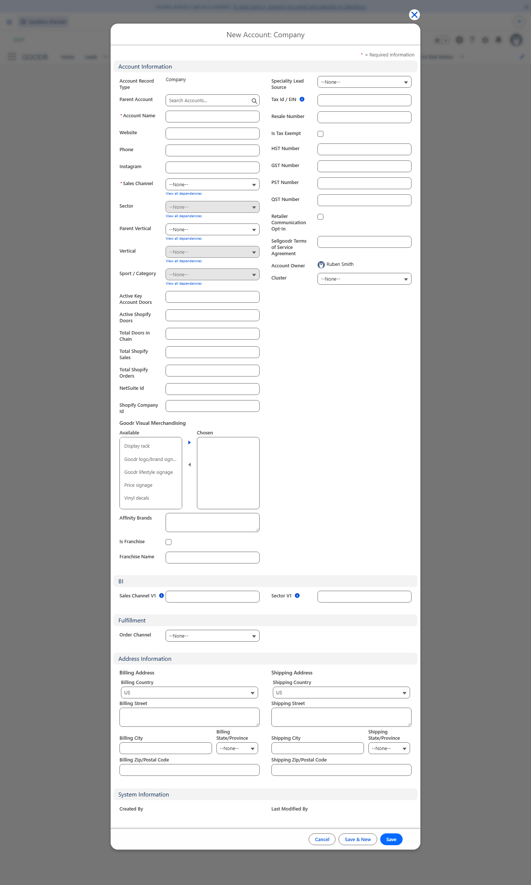
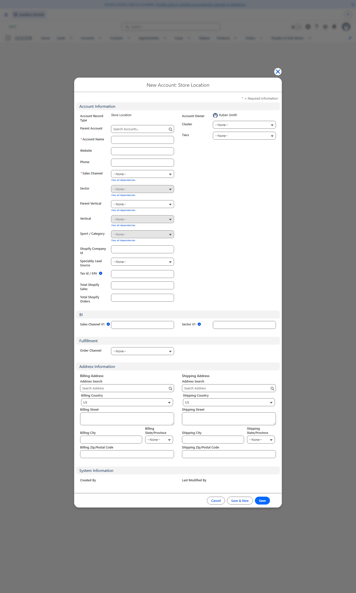
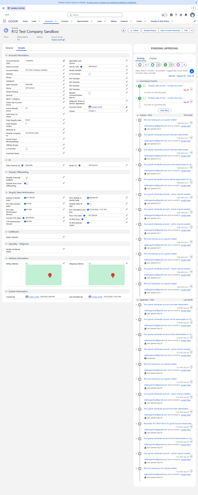
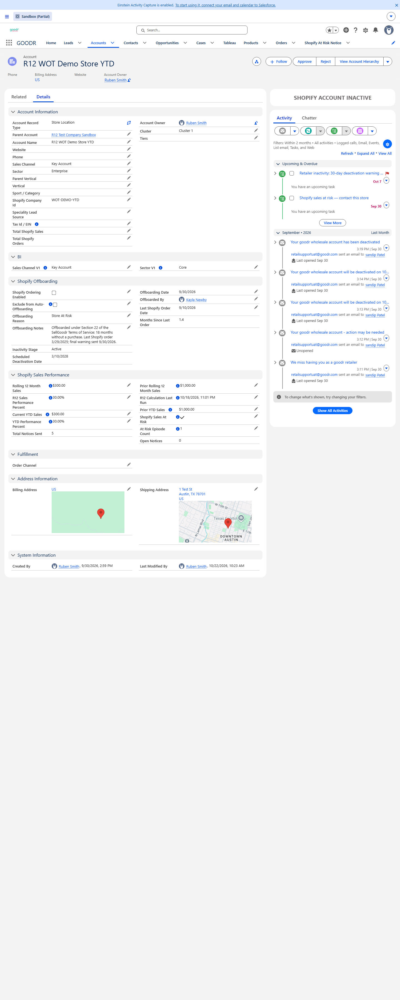
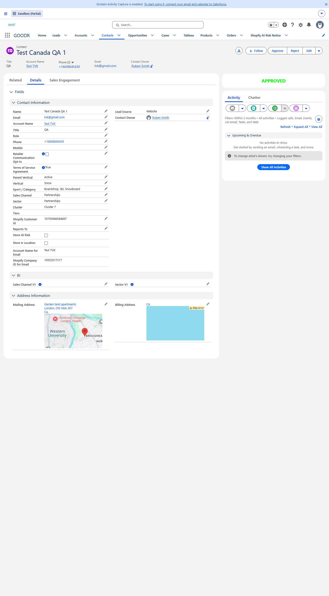
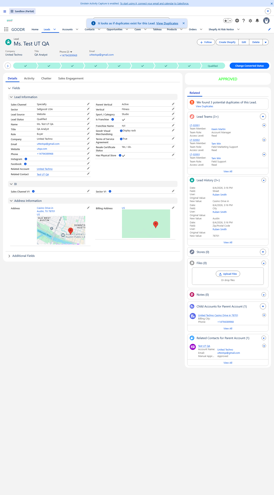
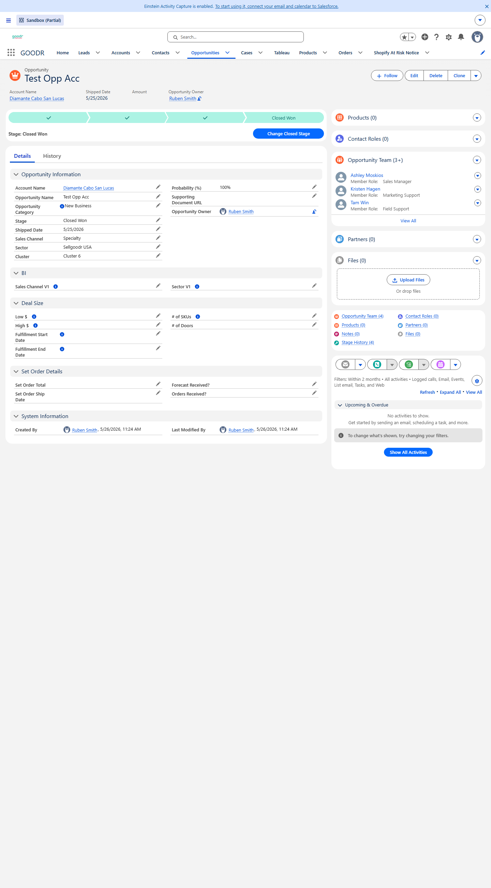

# MTC-004 — Hide the Shopify sections on create; V1 fields and BI section

| | |
|---|---|
| **Document** | MTC-004 |
| **Requirements** | REQ-037 · REQ-038 |
| **Automated test report** | [ATR-003](../01-Automated-Testing/ATR-003_Hide-Shopify-Sections-And-BI-V1-Fields.md): 28 of 28 scenarios passed on 2026-10-22 |
| **Environment** | Sandbox (GDRSAND), GOODR app |
| **How to use** | Run each test case in order. The **Expected result** is the outcome verified in the automated run. Write what you see in **Actual result** and mark **Status** as Pass or Fail. |

## What is being tested
- **New Account form:** the **Shopify Offboarding** and **Shopify Sales Performance** sections are hidden while a Company or Store Location is being created, and show again once it is saved.
- **BI section:** Account, Contact, Lead and Opportunity pages show a section named **BI** with **Sales Channel V1** and **Sector V1**.
- **Access:** only System Administrators can edit the V1 fields; Account Management users can read them.

## Before you start
You need a System Administrator login and an Account Management login. Use the test records named in each case. Do not save the New Account forms: close them with **Cancel**.

## Test case summary
| Test ID | Scenario | Expected result | Actual result | Status |
|---|---|---|---|---|
| TC-037-11 | New Company form | Neither Shopify section is shown | | |
| TC-037-12 | New Store Location form | Neither Shopify section is shown | | |
| TC-037-13 | Existing Company | Both Shopify sections are shown | | |
| TC-037-14 | Existing Store Location | Both Shopify sections are shown | | |
| TC-037-05 | Non-admin user sees the sections | Both sections shown on a saved Account | | |
| TC-037-09 | Is Saved Record is not on any page | The field is not shown anywhere | | |
| TC-038-11 | Account BI section | BI with Sales Channel V1 and Sector V1 and their values | | |
| TC-038-12 | Contact BI section | BI after Contact Information | | |
| TC-038-13 | Lead BI section | BI after Lead Information | | |
| TC-038-14 | Opportunity BI section | BI after Opportunity Information | | |
| TC-038-02 | Admin can edit V1 | Value saved | | |
| TC-038-03 | Account Management cannot edit V1 | Fields read only | | |
| TC-038-06 | 200 records at once | Covered by the automated test | | |

---

## Test cases

### TC-037-11 — New Company form
| | |
|---|---|
| **Preconditions** | Logged in as a System Administrator, GOODR app. |
| **Front-end steps** | 1. Open **Accounts** and click **New**. 2. Choose **Company** and click **Next**. 3. Scroll through the whole form. 4. Click **Cancel**. |
| **Backend check** | — |
| **Test data** | — |
| **Expected result** | Sections shown: Account Information, BI, Fulfillment, Address Information, System Information. **Shopify Offboarding** and **Shopify Sales Performance** are not shown. |
| **Actual result** | |
| **Status** | Pass / Fail |

### TC-037-12 — New Store Location form
| | |
|---|---|
| **Preconditions** | Logged in as a System Administrator. |
| **Front-end steps** | 1. Open **Accounts** and click **New**. 2. Choose **Store Location** and click **Next**. 3. Scroll through the whole form. 4. Click **Cancel**. |
| **Backend check** | — |
| **Test data** | — |
| **Expected result** | **Shopify Offboarding** and **Shopify Sales Performance** are not shown. |
| **Actual result** | |
| **Status** | Pass / Fail |

### TC-037-13 — Existing Company
| | |
|---|---|
| **Preconditions** | Logged in as a System Administrator. |
| **Front-end steps** | 1. Open the Account **R12 Test Company Sandbox**. 2. Open the **Details** tab and scroll down. |
| **Backend check** | — |
| **Test data** | R12 Test Company Sandbox |
| **Expected result** | **Shopify Offboarding** and **Shopify Sales Performance** are shown with their values (for example Rolling 12 Month Sales $77,900.00). |
| **Actual result** | |
| **Status** | Pass / Fail |

### TC-037-14 — Existing Store Location
| | |
|---|---|
| **Preconditions** | Logged in as a System Administrator. |
| **Front-end steps** | 1. Open the Account **R12 WOT Demo Store YTD**. 2. Open the **Details** tab and scroll down. |
| **Backend check** | — |
| **Test data** | R12 WOT Demo Store YTD |
| **Expected result** | **Shopify Offboarding** (Offboarding Reason "Store At Risk", Inactivity Stage "Active") and **Shopify Sales Performance** are shown. |
| **Actual result** | |
| **Status** | Pass / Fail |

### TC-037-05 — Non-admin user sees the sections
| | |
|---|---|
| **Preconditions** | Logged in as an Account Management user. |
| **Front-end steps** | 1. Open **R12 Test Company Sandbox**. 2. Open the **Details** tab. |
| **Backend check** | — |
| **Test data** | — |
| **Expected result** | Both Shopify sections are shown, as for the administrator. Automated run: Account Management can read Is Saved Record. |
| **Actual result** | |
| **Status** | Pass / Fail |

### TC-037-09 — Is Saved Record is not on any page
| | |
|---|---|
| **Preconditions** | Logged in as a System Administrator. |
| **Front-end steps** | 1. Open any Company and any Store Location Account. 2. Look through all sections on the Details tab. |
| **Backend check** | Setup → Object Manager → Account → Fields & Relationships → **Is Saved Record**: formula checkbox, "Where is this used?" lists only the two record pages. |
| **Test data** | — |
| **Expected result** | No field labelled "Is Saved Record" appears on any page. |
| **Actual result** | |
| **Status** | Pass / Fail |

### TC-038-11 — Account BI section
| | |
|---|---|
| **Preconditions** | Logged in as a System Administrator. |
| **Front-end steps** | 1. Open **R12 Test Company Sandbox** → **Details**. 2. Find the section **BI** below Account Information. |
| **Backend check** | Sales Channel V1 and Sector V1 are no longer inside Account Information. |
| **Test data** | — |
| **Expected result** | BI shows Sales Channel V1 "Specialty" and Sector V1 "Self Service". See the screenshot of TC-037-13. |
| **Actual result** | |
| **Status** | Pass / Fail |

### TC-038-12 — Contact BI section
| | |
|---|---|
| **Preconditions** | Logged in as a System Administrator. |
| **Front-end steps** | 1. Open the Contact **Test Canada QA 1** → **Details**. |
| **Backend check** | — |
| **Test data** | Test Canada QA 1 |
| **Expected result** | A **BI** section after Contact Information with Sales Channel V1 and Sector V1 (empty). |
| **Actual result** | |
| **Status** | Pass / Fail |

### TC-038-13 — Lead BI section
| | |
|---|---|
| **Preconditions** | Logged in as a System Administrator. |
| **Front-end steps** | 1. Open the Lead **Test UT QA** → **Details**. |
| **Backend check** | — |
| **Test data** | Test UT QA |
| **Expected result** | A **BI** section after Lead Information with Sales Channel V1 and Sector V1 (empty). |
| **Actual result** | |
| **Status** | Pass / Fail |

### TC-038-14 — Opportunity BI section
| | |
|---|---|
| **Preconditions** | Logged in as a System Administrator. |
| **Front-end steps** | 1. Open the Opportunity **Test Opp Acc** → **Details**. |
| **Backend check** | — |
| **Test data** | Test Opp Acc |
| **Expected result** | A **BI** section after Opportunity Information with Sales Channel V1 and Sector V1 (empty). |
| **Actual result** | |
| **Status** | Pass / Fail |

### TC-038-02 — Admin can edit V1
| | |
|---|---|
| **Preconditions** | Logged in as a System Administrator. |
| **Front-end steps** | 1. Open **Test Canada QA 1**. 2. In **BI**, click the pencil on Sales Channel V1, type `QA`, click **Save**. 3. Clear the value again and **Save**. |
| **Backend check** | Sales Channel V1 is blank again at the end. |
| **Test data** | QA |
| **Expected result** | The value saves, and is cleared again. Automated run: values saved and read back on Contact, Lead and Opportunity. |
| **Actual result** | |
| **Status** | Pass / Fail |

### TC-038-03 — Account Management cannot edit V1
| | |
|---|---|
| **Preconditions** | Logged in as an Account Management user. |
| **Front-end steps** | 1. Open **Test Canada QA 1** and **R12 Test Company Sandbox**. 2. Look at the **BI** section. |
| **Backend check** | — |
| **Test data** | — |
| **Expected result** | Sales Channel V1 and Sector V1 are visible but have no pencil (read only). |
| **Actual result** | |
| **Status** | Pass / Fail |

### TC-038-06 — 200 records at once
| | |
|---|---|
| **Preconditions** | — |
| **Front-end steps** | Covered by the automated test (200 Contacts saved with V1 values). Optional manual method: Data Loader insert of 200 test Contacts with both V1 columns, then delete them. |
| **Backend check** | Report on Contacts with Sales Channel V1 filled. |
| **Test data** | — |
| **Expected result** | All 200 saved. |
| **Actual result** | |
| **Status** | Pass / Fail |

---

## Sign-off
| | |
|---|---|
| **Tester name** | |
| **Test date** | |
| **Test cases passed** | ____ of 13 |
| **Overall result** | Pass / Fail |
| **Comments** | |
| **Signature** | |
