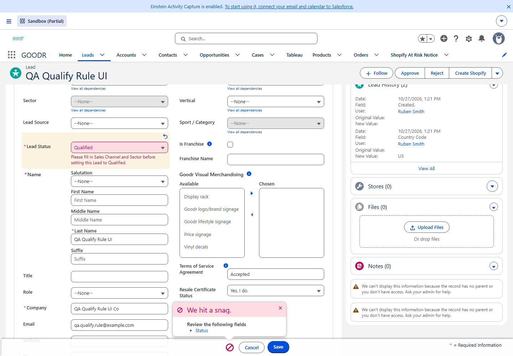
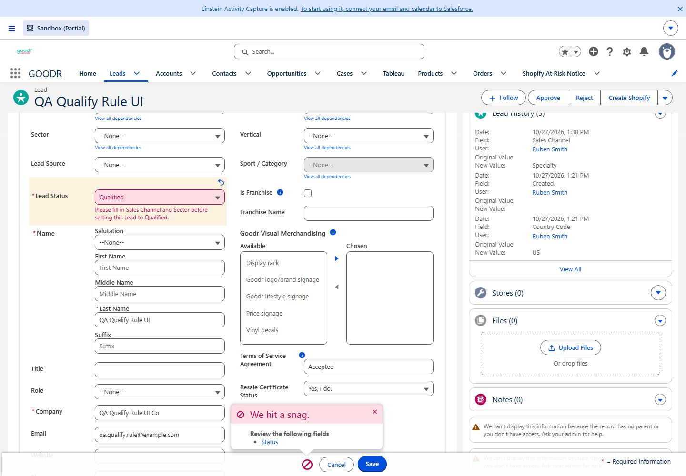
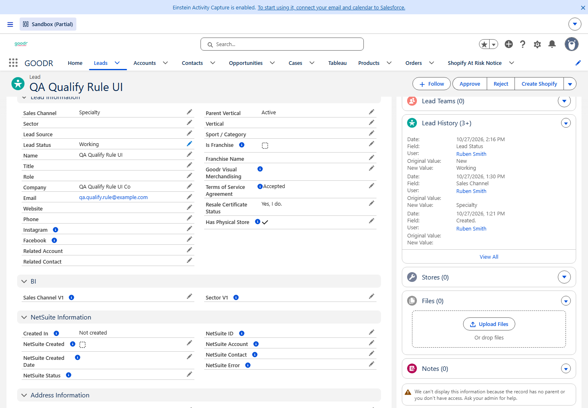
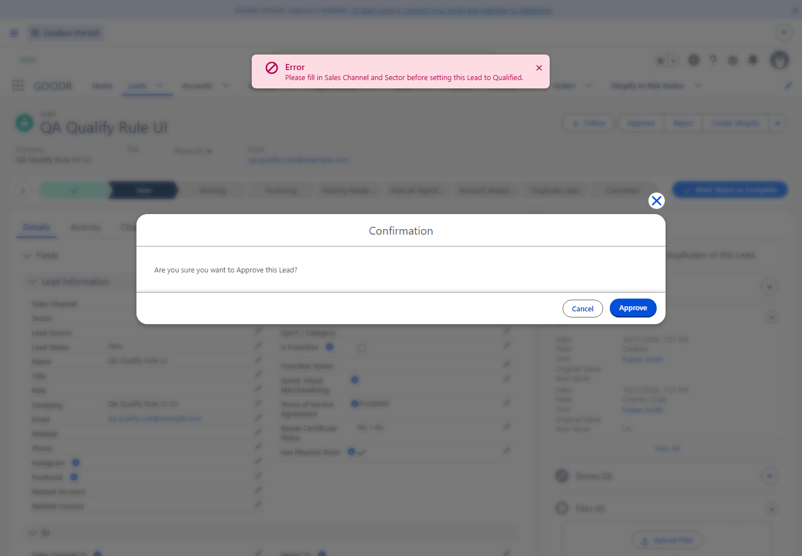
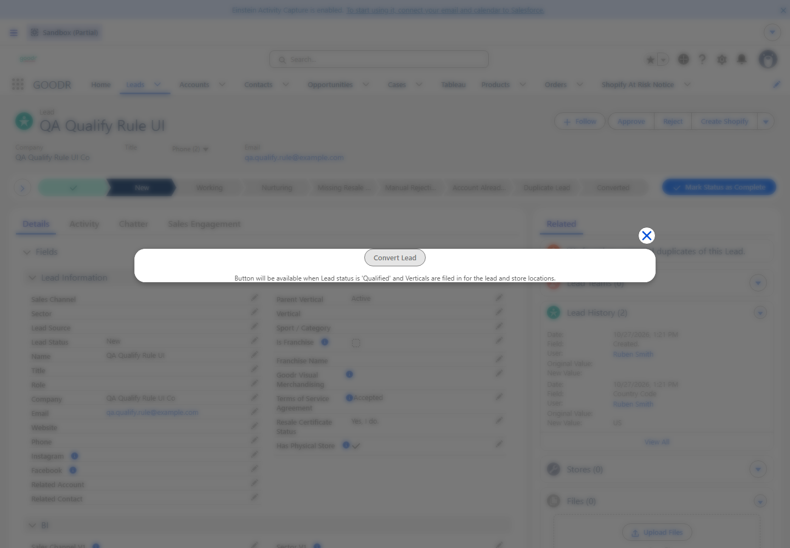
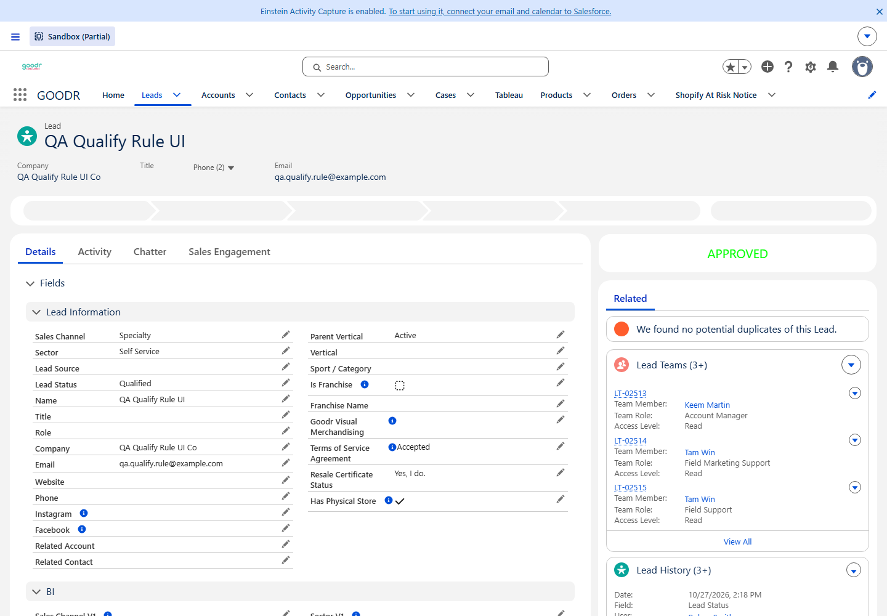
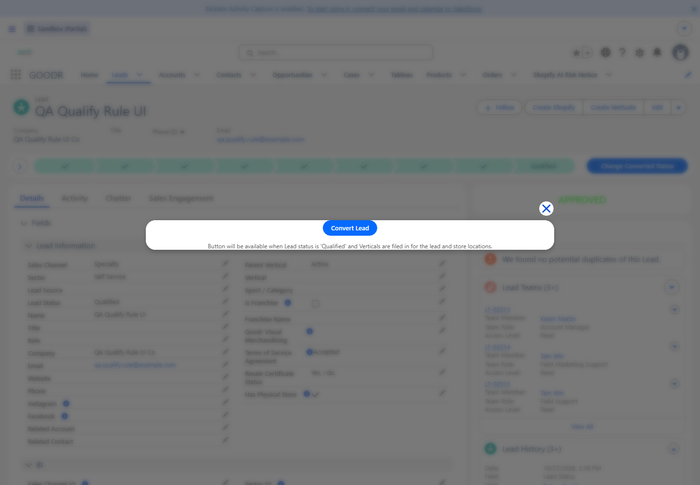

# MTC-005 — Lead validation rule: Sales Channel and Sector required to qualify

| | |
|---|---|
| **Document** | MTC-005 |
| **Requirement** | REQ-039 |
| **Automated test report** | [ATR-004](../01-Automated-Testing/ATR-004_Lead-Qualify-Validation-Rule.md): 15 of 15 scenarios passed on 2026-10-27 |
| **Environment** | Sandbox (GDRSAND), GOODR app |
| **On-screen run** | 2026-10-27, System Administrator, test Lead **QA Qualify Rule UI** (deleted afterwards, with its Lead Teams). Screenshots in `MTC-005_screenshots/` |
| **How to use** | Run each test case in order. The **Expected result** is the outcome verified in the automated and on-screen runs. Write what you see in **Actual result** and mark **Status** as Pass or Fail. |

## What is being tested
A Lead cannot be set to **Qualified** while **Sales Channel** or **Sector** is blank. Because **Create Shopify** only works on Qualified Leads, a Shopify customer can no longer be created without both values.

## Before you start
- Create a test Lead with Status **New** and these fields: a 9-digit Tax ID, an Email (use a test address), Terms of Service Agreement filled, Has Physical Store = Yes, Resale Certificate Status = "Yes, I do.", Parent Vertical filled. Leave **Sales Channel** and **Sector** blank.
- In the Status path, **Qualified** is the last step (shown as "Converted" until reached). Use the pencil on **Lead Status** or the **Approve** button.
- Don't click **Convert Lead** inside Create Shopify, because that creates Accounts in Shopify. Delete the test Lead at the end.

## Test case summary
| Test ID | Scenario | Expected result | Actual result (2026-10-27) | Status |
|---|---|---|---|---|
| TC-039-02 | Both blank → Lead Status Qualified | Error on Lead Status; Lead stays New | Error shown under Lead Status; stayed New | Pass |
| TC-039-01 | Sector blank → Lead Status Qualified | Same error | Error shown; stayed New | Pass |
| TC-039-07 | Sector blank → Lead Status Working | Saved | Saved as Working | Pass |
| TC-039-09 | Approve with Sector blank | Error; Lead stays New | Red error toast with the rule message; stayed New | Pass |
| TC-039-12 | Create Shopify before qualifying | Convert Lead disabled | Disabled (grey) | Pass |
| TC-039-10 | Approve with both filled | Qualified | Qualified, "APPROVED" shown, Lead Teams assigned | Pass |
| TC-039-12 | Create Shopify after qualifying | Convert Lead enabled | Enabled (blue); not clicked | Pass |
| TC-039-05 | Create a Lead with blanks | Saved | Saved (test Lead created this way) | Pass |
| TC-039-11 | Reject with blanks | Manual Rejection | Automated test only (on screen it sends the rejection email) | — |

---

## Test cases

### TC-039-02 — Both blank → Lead Status Qualified
| | |
|---|---|
| **Preconditions** | Test Lead, Status New, Sales Channel and Sector blank. |
| **Front-end steps** | 1. Open the Lead. 2. Click the pencil on **Lead Status**, choose **Qualified**. 3. Click **Save**. |
| **Backend check** | Status is still New. |
| **Test data** | Both blank |
| **Expected result** | Under Lead Status: *"Please fill in Sales Channel and Sector before setting this Lead to Qualified."* |
| **Actual result** | As expected |
| **Status** | Pass |

### TC-039-01 — Sector blank → Lead Status Qualified
| | |
|---|---|
| **Preconditions** | Set Sales Channel to **Specialty**, leave Sector blank. |
| **Front-end steps** | Repeat the TC-039-02 steps. |
| **Backend check** | Status is still New. |
| **Test data** | Specialty, Sector blank |
| **Expected result** | The same error. |
| **Actual result** | As expected |
| **Status** | Pass |

### TC-039-07 — Other status with Sector blank
| | |
|---|---|
| **Preconditions** | As TC-039-01. Click **Cancel** on the failed edit. |
| **Front-end steps** | Pencil on **Lead Status** → **Working** → **Save**. |
| **Backend check** | Status is Working. |
| **Test data** | — |
| **Expected result** | Saved, no error. |
| **Actual result** | Saved as Working |
| **Status** | Pass |

### TC-039-09 — Approve with a blank value
| | |
|---|---|
| **Preconditions** | Sales Channel or Sector blank. |
| **Front-end steps** | 1. Click **Approve**. 2. In the Confirmation window click **Approve**. |
| **Backend check** | Status unchanged. |
| **Test data** | — |
| **Expected result** | Red "Error" message with the rule's text. |
| **Actual result** | As expected |
| **Status** | Pass |

### TC-039-12 (before) — Create Shopify on a Lead that isn't Qualified
| | |
|---|---|
| **Preconditions** | Lead not Qualified. |
| **Front-end steps** | Click **Create Shopify**, look at the window, close it with **X**. |
| **Backend check** | — |
| **Test data** | — |
| **Expected result** | **Convert Lead** is grey (disabled), with the note "Button will be available when Lead status is 'Qualified'...". |
| **Actual result** | As expected |
| **Status** | Pass |

### TC-039-10 / TC-039-03 — Approve with both filled
| | |
|---|---|
| **Preconditions** | Sales Channel **Specialty**, Sector **Self Service**. |
| **Front-end steps** | Click **Approve** → **Approve**. |
| **Backend check** | Status is Qualified. |
| **Test data** | Specialty / Self Service |
| **Expected result** | Lead is Qualified, no error. |
| **Actual result** | Qualified; "APPROVED" shown; Lead Teams assigned by the cluster automation |
| **Status** | Pass |

### TC-039-12 (after) — Create Shopify on a Qualified Lead
| | |
|---|---|
| **Preconditions** | Lead from TC-039-10. |
| **Front-end steps** | Click **Create Shopify**, look at the window, close it with **X**. **Don't click Convert Lead.** |
| **Backend check** | Shopify Created is still false. |
| **Test data** | — |
| **Expected result** | **Convert Lead** is blue (enabled). |
| **Actual result** | As expected |
| **Status** | Pass |

### TC-039-11 — Reject with blanks
| | |
|---|---|
| **Preconditions** | A separate Lead with Sales Channel and Sector blank and a **test** email address. |
| **Front-end steps** | Click **Reject** → confirm. |
| **Backend check** | Status is Manual Rejection. |
| **Test data** | — |
| **Expected result** | Rejected as before. This sends the rejection email. |
| **Actual result** | Covered by the automated test (TC-039-11 in ATR-004) |
| **Status** | |

---

## Cleanup
The test Lead and its 6 Lead Team rows were deleted after the run. No Accounts, Contacts or Shopify records were created.

## Sign-off
| | |
|---|---|
| **Tester name** | |
| **Test date** | |
| **Test cases passed** | ____ of 9 |
| **Overall result** | Pass / Fail |
| **Comments** | |
| **Signature** | |
