# MTC-001 — Edit Agreement and locked agreement fields

| | |
|---|---|
| **Document** | MTC-001 |
| **Requirement** | REQ-014 Agreement Flow (create and edit) and locked agreement fields |
| **Automated test report** | [ATR-001](../01-Automated-Testing/ATR-001_Edit-Agreement-And-Locked-Agreement-Fields.md): 24 of 24 scenarios passed (2026-10-19, retested 2026-10-21 after create and edit were combined); one defect found and fixed (DEF-001) |
| **Environment** | Sandbox (UTDEV), Marlins Sales app, Ticketing Opportunities |
| **How to use** | Run each test case in order. The **Expected result** is the outcome verified in the automated run. Write what you see in **Actual result** and mark **Status** as Pass or Fail. |

## What is being tested
- **Create Agreement** and **Edit Agreement** open the same flow. With no agreement it asks for the type and starts blank; with an agreement it skips the type question and opens prefilled.
- **Edit Agreement** reopens a saved agreement (Membership, Multi-Product, Flex or Suite Lease) with every value filled in, so it can be changed and saved again. Membership rows are updated in place; rows are added or removed when the row count changes.
- **Agreement details are locked.** The fields in the four agreement sections of the Opportunity, and the Membership Agreement rows, can only be changed through Create Agreement or Edit Agreement. Manual edits are blocked for every user, including administrators.

## Before you start
You need a System Administrator login and a Sales Manager login (Marlins Sales Leadership profile, Sales Managers role) for the sandbox, one Opportunity of each agreement type, and one Opportunity with no agreement. Note the values you change so you can put them back after testing.

**Error messages used below**
- **Opportunity rule:** "Agreement details can't be edited manually. Please use the Edit Agreement button on the Opportunity."
- **Membership row rule:** "Membership Agreement records can't be edited manually. Please use the Edit Agreement button on the Opportunity."

## Test case summary
| Test ID | Scenario | Expected result | Actual result | Status |
|---|---|---|---|---|
| TC-014-01 | Creating Membership rows is not blocked | Agreement saves; new row appears | | |
| TC-014-02 | Administrator cannot edit a Membership row manually | Blocked with the Membership row rule message | | |
| TC-014-03 | Sales Manager cannot edit a Membership row manually | Blocked with the Membership row rule message | | |
| TC-014-04 | Edit Agreement updates the existing Membership rows | Same rows updated, no new row numbers | | |
| TC-014-05 | Manual edit blocked again after an Edit Agreement save | Blocked with the Membership row rule message | | |
| TC-014-06 | Bulk: 200 rows | All 200 manual updates rejected | | |
| TC-014-07 | Rows removed when the row count is lowered | Surplus rows deleted | | |
| TC-014-08 | Administrator cannot edit agreement fields on the Opportunity | Each save blocked with the Opportunity rule message | | |
| TC-014-09 | Sales Manager cannot edit agreement fields on the Opportunity | Blocked with the Opportunity rule message | | |
| TC-014-10 | Create and Edit Agreement can change agreement fields | Saves through the buttons are not blocked | | |
| TC-014-11 | Other Opportunity fields stay editable | Next Step saves normally | | |
| TC-014-12 | New Opportunity with agreement values | New Opportunity saves | | |
| TC-014-13 | Changing Paid to Date through Edit Agreement | Saves; Opportunity Total Paid to Date updated | | |
| TC-014-14 | Only one agreement button shows | Create Agreement or Edit Agreement, never both | | |
| TC-014-15 | Suite Lease opens pre-filled | Every field shows the saved value | | |
| TC-014-16 | Edit and save a Suite Lease agreement | Saved, words and due date recalculated | | |
| TC-014-17 | Edit and save a Multi-Product agreement | Pre-filled; total recalculated | | |
| TC-014-18 | Edit and save a Membership agreement | Pre-filled; same rows updated | | |
| TC-014-19 | Membership: add rows | Existing rows kept, new rows created | | |
| TC-014-20 | Membership: remove rows | Surplus rows deleted | | |
| TC-014-21 | Flex: create, then edit | Created, then pre-filled and updated | | |
| TC-014-22 | Manual edit right after an Edit Agreement save | Blocked with the Membership row rule message | | |
| TC-014-23 | New agreement starts blank | Type screen shown; screens blank | | |
| TC-014-24 | Existing agreement opens prefilled without the type screen | No type screen; saved values shown | | |

---

## Test cases

### TC-014-01 — Creating Membership rows is not blocked
| | |
|---|---|
| **Preconditions** | Logged in as a System Administrator. An Opportunity with no agreement yet. |
| **Front-end steps** | 1. Click **Create Agreement**. 2. Choose **Membership**, click **Next**. 3. Enter Number of Rows (Tickets) = 1, leave Parking unticked, click **Next**. 4. Fill in the row details, click **Next**. 5. Fill in the Membership terms, click **Next**. |
| **Backend check** | Opportunity > Membership Agreements related list: one new row. |
| **Test data** | 1 ticket row, valid seat details |
| **Expected result** | The agreement saves. The summary says "1 record(s) saved in Membership Agreement." and the new row appears. |
| **Actual result** | |
| **Status** | Pass / Fail |

### TC-014-02 — Administrator cannot edit a Membership row manually
| | |
|---|---|
| **Preconditions** | Logged in as a System Administrator. An Opportunity with a Membership agreement and at least one row. |
| **Front-end steps** | 1. Open a Membership Agreement row (for example MA-417). 2. Click the pencil next to **Seat Quantity**. 3. Change the value and click **Save**. 4. Click **Cancel**. |
| **Backend check** | Seat Quantity on the row is unchanged. |
| **Test data** | Seat Quantity: any new value |
| **Expected result** | The save is stopped with the Membership row rule message. Nothing changes. |
| **Actual result** | |
| **Status** | Pass / Fail |

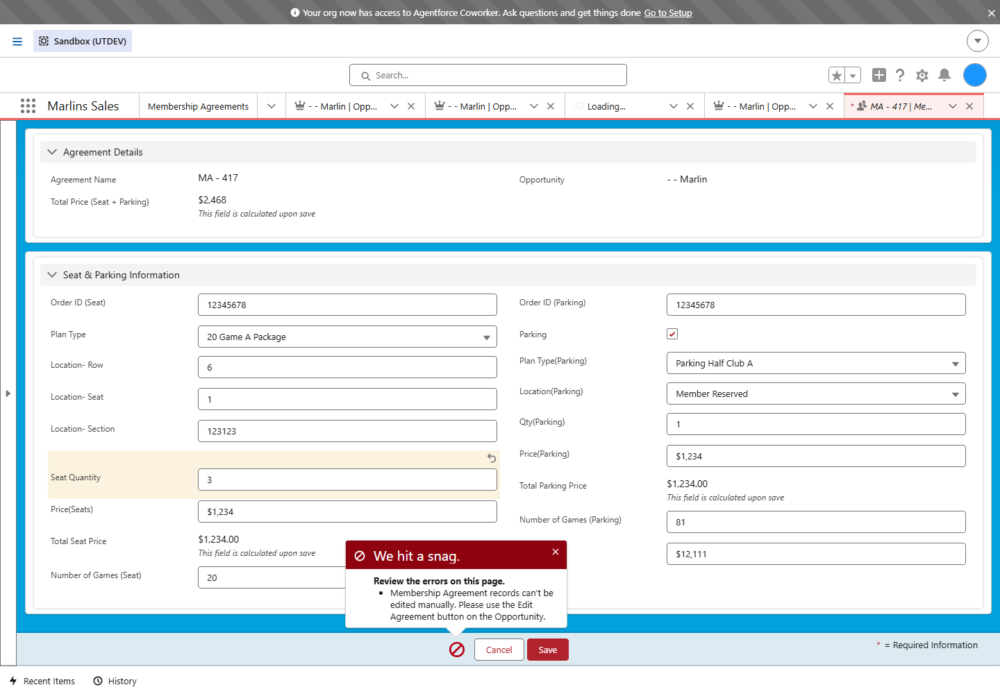

### TC-014-03 — Sales Manager cannot edit a Membership row manually
| | |
|---|---|
| **Preconditions** | Logged in as a Sales Manager. An Opportunity with a Membership agreement and at least one row. |
| **Front-end steps** | 1. Open a Membership Agreement row. 2. Click the pencil next to **Seat Quantity**, change it, click **Save**. 3. Click **Cancel**. |
| **Backend check** | Seat Quantity on the row is unchanged. |
| **Test data** | Seat Quantity: any new value |
| **Expected result** | The save is stopped with the Membership row rule message. |
| **Actual result** | |
| **Status** | Pass / Fail |

### TC-014-04 — Edit Agreement updates the existing Membership rows
| | |
|---|---|
| **Preconditions** | Logged in as a System Administrator. An Opportunity with a Membership agreement and rows. |
| **Front-end steps** | 1. Note the row names (for example MA-417, MA-418). 2. Click **Edit Agreement** and click **Next** through the screens, changing one value on Row 1. 3. Click **Next** on the terms screen to save, then **Finish**. |
| **Backend check** | Row names (MA-###) are the same as before; the changed value is saved on Row 1. |
| **Test data** | Row 1 Price per seat: new value |
| **Expected result** | The same rows are updated (no new row numbers). The changed value shows on Row 1. |
| **Actual result** | |
| **Status** | Pass / Fail |

### TC-014-05 — Manual edit blocked again after an Edit Agreement save
| | |
|---|---|
| **Preconditions** | Logged in as a System Administrator. TC-014-04 completed. |
| **Front-end steps** | 1. Open the row changed in TC-014-04. 2. Click the pencil next to **Seat Quantity**, change it, click **Save**. 3. Click **Cancel**. |
| **Backend check** | Seat Quantity unchanged. |
| **Test data** | Seat Quantity: any new value |
| **Expected result** | Blocked with the Membership row rule message. |
| **Actual result** | |
| **Status** | Pass / Fail |

### TC-014-06 — Bulk: 200 rows
| | |
|---|---|
| **Preconditions** | Backend scenario. |
| **Front-end steps** | 1. Covered by the automated test (ATR-001). No manual steps required. 2. Optional: with Data Loader, try updating Seat Quantity on 200 Membership Agreement rows. |
| **Backend check** | The Data Loader error file lists the rule message for every row. |
| **Test data** | 200 rows |
| **Expected result** | All 200 manual updates are rejected with the Membership row rule message. Automated run: 200 of 200 blocked; 200 flow updates saved. |
| **Actual result** | |
| **Status** | Pass / Fail |

### TC-014-07 — Rows removed when the row count is lowered
| | |
|---|---|
| **Preconditions** | Logged in as a System Administrator. An Opportunity with a Membership agreement. |
| **Front-end steps** | 1. See TC-014-20 for the steps. |
| **Backend check** | Membership Agreements related list. |
| **Test data** | Lower Number of Rows (Tickets) |
| **Expected result** | Surplus rows are deleted. |
| **Actual result** | |
| **Status** | Pass / Fail |

### TC-014-08 — Administrator cannot edit agreement fields on the Opportunity
| | |
|---|---|
| **Preconditions** | Logged in as a System Administrator. An Opportunity with a Suite Lease agreement. |
| **Front-end steps** | 1. Open the Opportunity and click **Edit**. 2. Change **Parking Passes** in the Suite Lease Details section. 3. Click **Save**. 4. Click **Cancel**. 5. Repeat with one field from each other agreement section on an Opportunity of that type (Membership: Term Length; Multi-Product: Amount allocated to Flex; Flex: Total Due Today). |
| **Backend check** | Field values unchanged. |
| **Test data** | Parking Passes: 12 |
| **Expected result** | Each save is stopped with the Opportunity rule message. |
| **Actual result** | |
| **Status** | Pass / Fail |

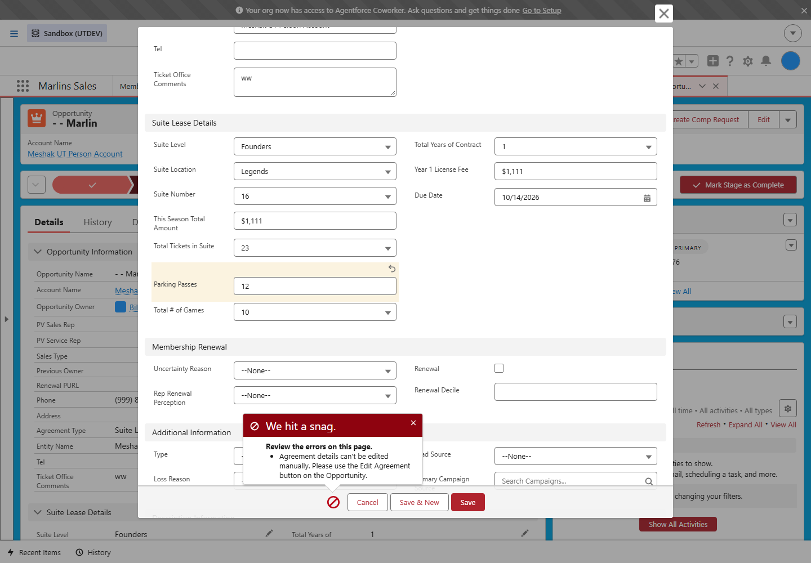

### TC-014-09 — Sales Manager cannot edit agreement fields on the Opportunity
| | |
|---|---|
| **Preconditions** | Logged in as a Sales Manager. An Opportunity with a Suite Lease agreement. |
| **Front-end steps** | 1. Open the Opportunity and click **Edit**. 2. Change **Parking Passes** and click **Save**. 3. Click **Cancel**. |
| **Backend check** | Parking Passes unchanged. |
| **Test data** | Parking Passes: any new value |
| **Expected result** | Blocked with the Opportunity rule message. |
| **Actual result** | |
| **Status** | Pass / Fail |

### TC-014-10 — Create and Edit Agreement can change agreement fields
| | |
|---|---|
| **Preconditions** | Covered by TC-014-16, 17, 18 and 21. |
| **Front-end steps** | No separate steps. |
| **Backend check** | — |
| **Test data** | — |
| **Expected result** | Saves made through Create Agreement and Edit Agreement are not blocked. |
| **Actual result** | |
| **Status** | Pass / Fail |

### TC-014-11 — Other Opportunity fields stay editable
| | |
|---|---|
| **Preconditions** | Logged in as a Sales Manager. An Opportunity with a Suite Lease agreement. |
| **Front-end steps** | 1. Open the Opportunity and click the pencil next to **Next Step**. 2. Type a value and click **Save**. 3. Clear the value again and save. |
| **Backend check** | Next Step shows the typed value. |
| **Test data** | Next Step: "QA next step" |
| **Expected result** | Saves normally. |
| **Actual result** | |
| **Status** | Pass / Fail |

### TC-014-12 — New Opportunity with agreement values
| | |
|---|---|
| **Preconditions** | Logged in as a System Administrator. |
| **Front-end steps** | 1. Clone an Opportunity that has an agreement, or create a new Ticketing Opportunity and fill an agreement field. 2. Click **Save**. |
| **Backend check** | The new Opportunity is created. |
| **Test data** | Any agreement value |
| **Expected result** | The new Opportunity saves (the rule applies only to edits of existing records). |
| **Actual result** | |
| **Status** | Pass / Fail |

### TC-014-13 — Changing Paid to Date through Edit Agreement
| | |
|---|---|
| **Preconditions** | Logged in as a System Administrator. An Opportunity with a Membership agreement. |
| **Front-end steps** | 1. Click **Edit Agreement** and click **Next** to the Membership terms screen. 2. Change **Paid to Date**. 3. Click **Next** to save, then **Finish**. |
| **Backend check** | Opportunity > Membership Agreement Details > Total Paid to Date shows the new amount; each Membership row shows the new Paid to Date. |
| **Test data** | Paid to Date: 12,500 |
| **Expected result** | Saves without an error. Opportunity Total Paid to Date = 12,500. This scenario failed in the first automated run and was fixed (DEF-001). |
| **Actual result** | |
| **Status** | Pass / Fail |

### TC-014-14 — Only one agreement button shows
| | |
|---|---|
| **Preconditions** | Logged in as a System Administrator. One Opportunity with no agreement and one with a Suite Lease agreement. |
| **Front-end steps** | 1. Open the Opportunity with no agreement and look at the buttons in the top-right. 2. Open the Suite Lease Opportunity and look at the buttons. |
| **Backend check** | Agreement Type is blank on the first, Suite Lease on the second. |
| **Test data** | — |
| **Expected result** | No agreement: Create Agreement shows, Edit Agreement does not. With an agreement: Edit Agreement shows, Create Agreement does not. |
| **Actual result** | |
| **Status** | Pass / Fail |

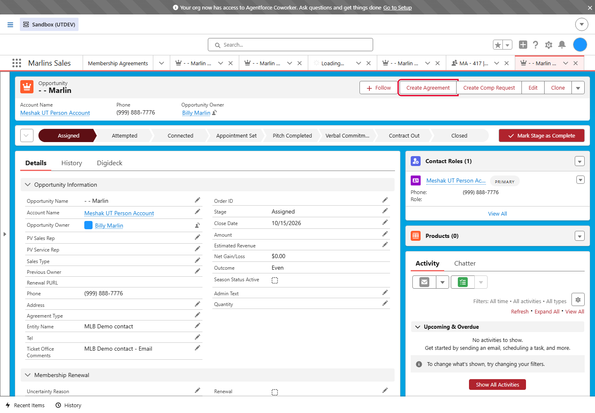
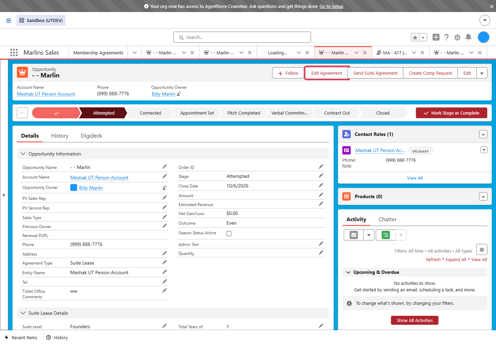

### TC-014-15 — Suite Lease opens pre-filled
| | |
|---|---|
| **Preconditions** | Logged in as a System Administrator. An Opportunity with a Suite Lease agreement. |
| **Front-end steps** | 1. Click **Edit Agreement**. 2. Compare each field with the Suite Lease Details section on the Opportunity. |
| **Backend check** | Opportunity Suite Lease Details section. |
| **Test data** | — |
| **Expected result** | Every field shows the saved value. Automated run: Legends, 16, Founders, 23 tickets, 10 games, 1 year, $1,111.00, Parking Pass 11. |
| **Actual result** | |
| **Status** | Pass / Fail |

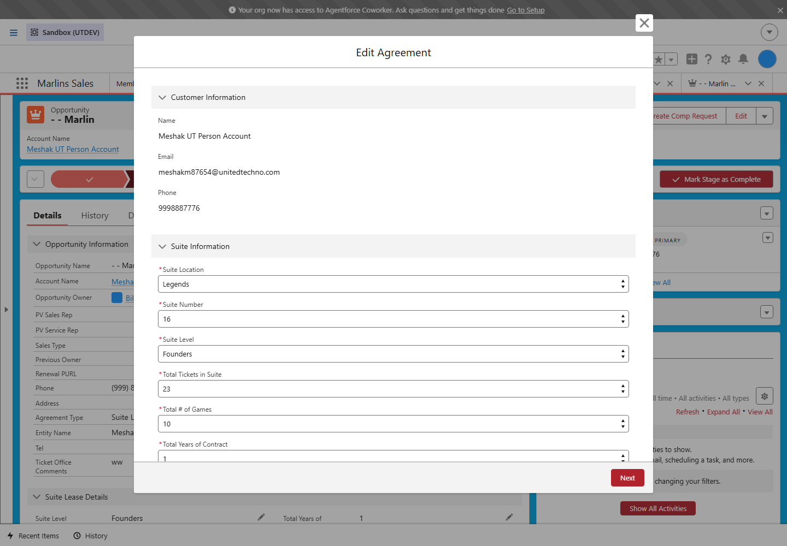

### TC-014-16 — Edit and save a Suite Lease agreement
| | |
|---|---|
| **Preconditions** | Logged in as a System Administrator. An Opportunity with a Suite Lease agreement. |
| **Front-end steps** | 1. Click **Edit Agreement**. 2. Change **Parking Pass** to 12 and **Total # of Games** to 40. 3. Leave Entity Name on **Leave As Is**. 4. Click **Next**, check the summary, click **Finish**. |
| **Backend check** | Opportunity: Parking Passes = 12, Total # of Games = 40, Total # of Games in Words = "Forty (40)", Entity Name unchanged, Due Date = today + 3 business days. |
| **Test data** | Parking Pass 12; Games 40 |
| **Expected result** | Saved. Summary shows "Total # of Games: Forty (40)". Automated run: Parking 12, Games 40, "Forty (40)", Entity Name unchanged, Due Date 22 Oct 2026 (run on 19 Oct). |
| **Actual result** | |
| **Status** | Pass / Fail |

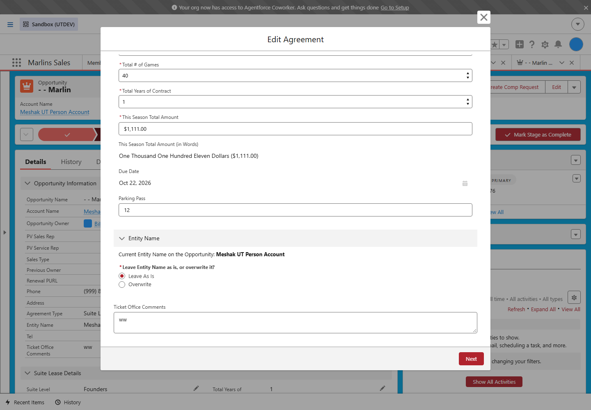
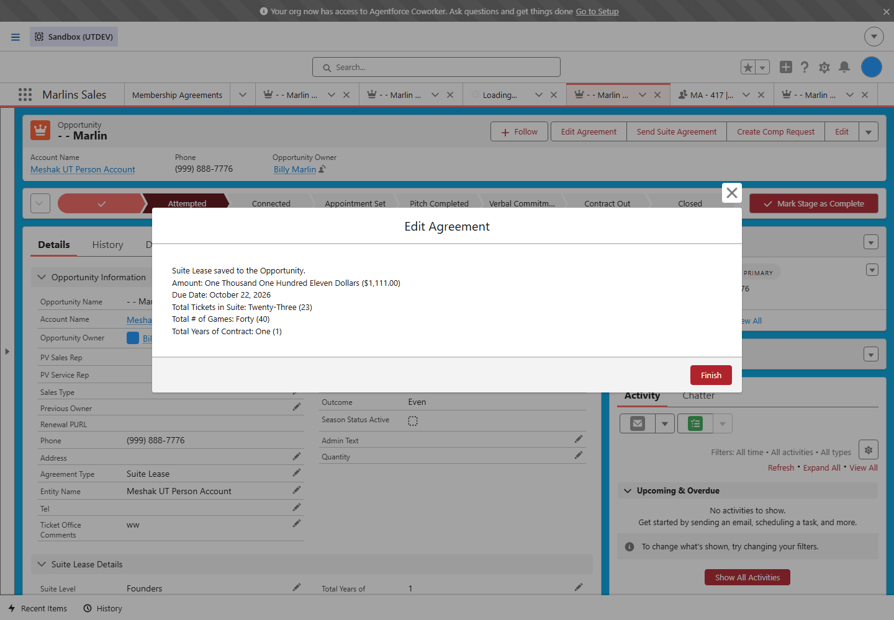

### TC-014-17 — Edit and save a Multi-Product agreement
| | |
|---|---|
| **Preconditions** | Logged in as a System Administrator. An Opportunity with a Multi-Product agreement. |
| **Front-end steps** | 1. Click **Edit Agreement**. 2. Check the amounts and season are filled in. 3. Change **Amount for Flex**. 4. Click **Next**, then **Finish**. |
| **Backend check** | Opportunity: Amount allocated to Flex and Total Multi Product updated. |
| **Test data** | Amount for Flex: 1 to 5 (Group 1, Suite 1) |
| **Expected result** | Pre-filled with the saved amounts. Total Multi Product recalculated: 5 + 1 + 1 = 7. |
| **Actual result** | |
| **Status** | Pass / Fail |

### TC-014-18 — Edit and save a Membership agreement
| | |
|---|---|
| **Preconditions** | Logged in as a System Administrator. An Opportunity with a Membership agreement and rows. |
| **Front-end steps** | 1. Click **Edit Agreement**. Check the row counts are filled in, click **Next**. 2. On Row 1, check the seat and parking details are filled in. Change **Price per seat**. Click **Next**. 3. Click **Next** on any further rows. 4. On the terms screen, check the term, seasons and payments are filled in. Change **Paid to Date**. 5. Click **Next** to save, then **Finish**. |
| **Backend check** | Rows keep the same names (MA-###). Row 1 Price(Seats) and every row's Paid to Date updated. Opportunity Total Paid to Date updated. |
| **Test data** | Price per seat 1,234 to 1,500; Paid to Date 12,111 to 12,500 |
| **Expected result** | All screens pre-filled. The same rows are updated (automated run: MA-417 and MA-418 kept their IDs). Price 1,500; Paid to Date 12,500 on the rows and the Opportunity. |
| **Actual result** | |
| **Status** | Pass / Fail |

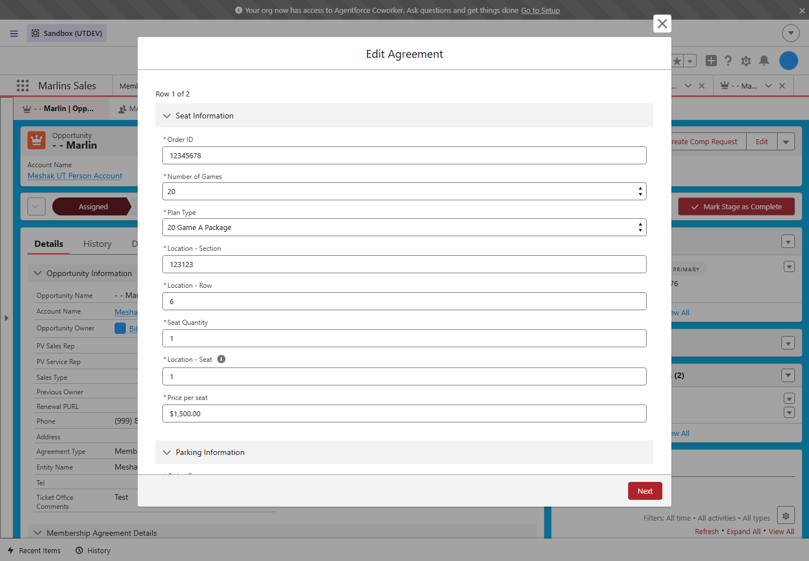
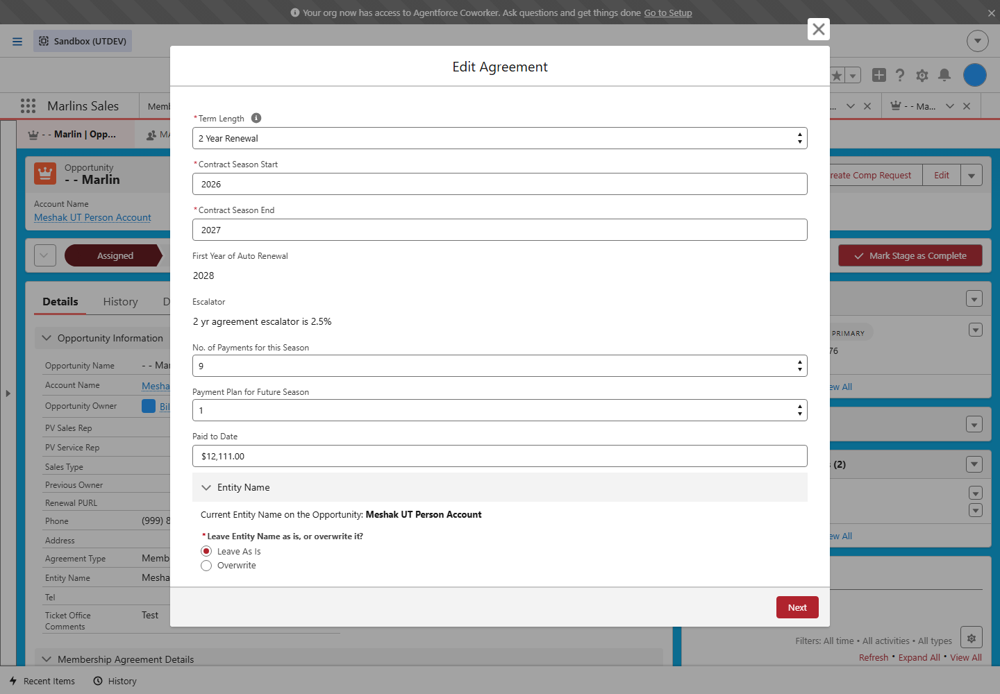

### TC-014-19 — Membership: add rows
| | |
|---|---|
| **Preconditions** | Logged in as a System Administrator. An Opportunity with a Membership agreement. |
| **Front-end steps** | 1. Click **Edit Agreement**. 2. Raise **Number of Rows (Tickets)** by 2 and click **Next**. 3. Existing rows show their saved values; fill in the seat details on the new rows. 4. Click **Next** through to the terms screen, then **Next** to save. |
| **Backend check** | Membership Agreements related list: existing rows kept, new rows added. |
| **Test data** | Number of Rows (Tickets): 1 to 3 |
| **Expected result** | Existing rows keep their names; the extra rows are created (automated run: MA-421 created). |
| **Actual result** | |
| **Status** | Pass / Fail |

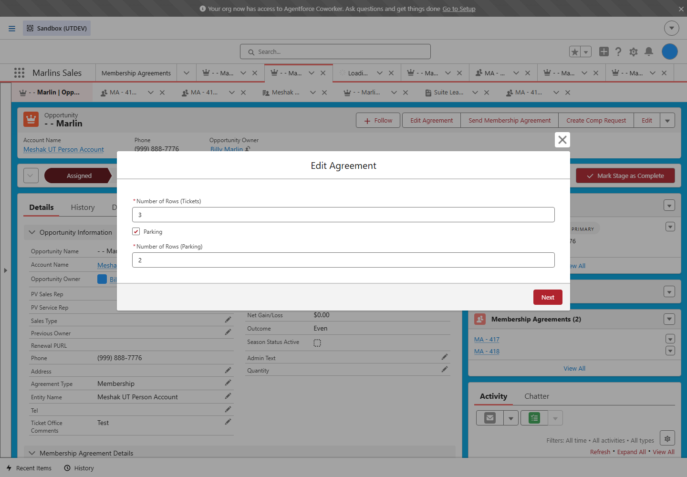
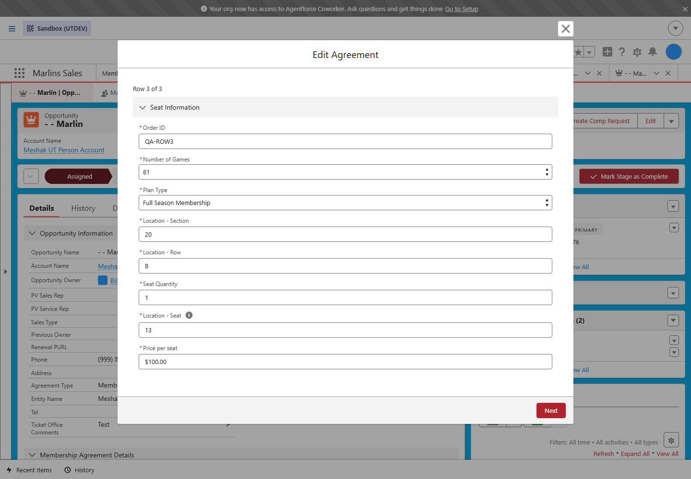

### TC-014-20 — Membership: remove rows
| | |
|---|---|
| **Preconditions** | Logged in as a System Administrator. TC-014-19 completed. |
| **Front-end steps** | 1. Click **Edit Agreement**. 2. Lower **Number of Rows (Tickets)** back to the original value and click **Next**. 3. Click **Next** through the rows and terms to save. |
| **Backend check** | Membership Agreements related list. |
| **Test data** | Number of Rows (Tickets): 3 to 1 |
| **Expected result** | Rows no longer needed are deleted; a row that only has parking keeps its parking and loses its seat details. Automated run: MA-421 deleted, MA-418 seat details cleared. |
| **Actual result** | |
| **Status** | Pass / Fail |

### TC-014-21 — Flex: create, then edit
| | |
|---|---|
| **Preconditions** | Logged in as a System Administrator. An Opportunity with no agreement yet. |
| **Front-end steps** | 1. Click **Create Agreement**, choose **Flex**, click **Next**. 2. Enter Total flex Membership 6,000, choose **PIF**, Current Season 2026. Click **Next**, then **Finish**. 3. Check the button is now **Edit Agreement**. Click it. 4. Check the values are filled in. Change Total flex Membership to 6,500. 5. Click **Next**, then **Finish**. |
| **Backend check** | Opportunity Flex Membership Information: Total Flex Membership, Payment Plan, Total Due Today, Beginning and Starting Season. |
| **Test data** | Create: 6,000 / PIF / 2026. Edit: 6,500 |
| **Expected result** | Created: total 6,000, PIF, Total Due Today 6,000, season 2026, auto renewal 2027. Edit opens pre-filled; after saving: total 6,500, Total Due Today 6,500. |
| **Actual result** | |
| **Status** | Pass / Fail |

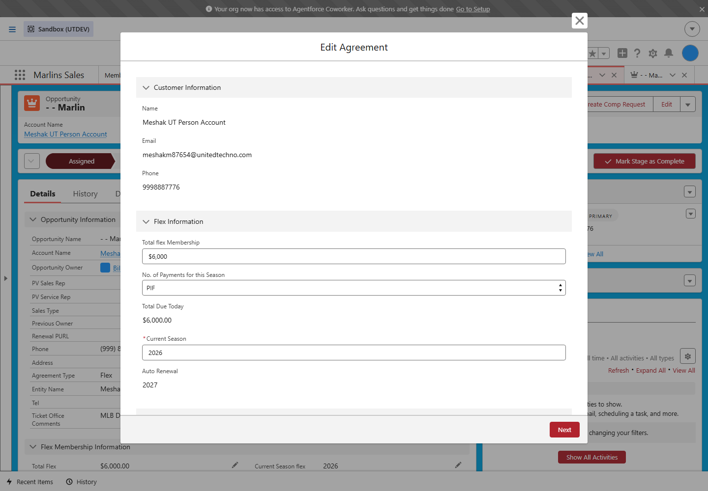

### TC-014-22 — Manual edit right after an Edit Agreement save
| | |
|---|---|
| **Preconditions** | Logged in as a System Administrator. TC-014-18 completed. |
| **Front-end steps** | 1. Open Membership row MA-417 (or Row 1). 2. Click the pencil next to **Seat Quantity**, change it, click **Save**. 3. Click **Cancel**. |
| **Backend check** | Seat Quantity unchanged. |
| **Test data** | Seat Quantity: 4 |
| **Expected result** | Blocked with the Membership row rule message. |
| **Actual result** | |
| **Status** | Pass / Fail |

### TC-014-23 — New agreement starts blank
| | |
|---|---|
| **Preconditions** | Logged in as a System Administrator. An Opportunity with no agreement yet (Agreement Type blank). |
| **Front-end steps** | 1. Click **Create Agreement**. 2. Check the **Select Agreement Type** screen appears. Choose **Membership**, click **Next**. 3. Check Number of Rows (Tickets) is empty and Parking is unticked. 4. Close the window without saving. |
| **Backend check** | Agreement Type on the Opportunity is still blank. |
| **Test data** | — |
| **Expected result** | The type screen is shown and the Membership screens start blank, even if the Opportunity holds old hidden values. |
| **Actual result** | |
| **Status** | Pass / Fail |

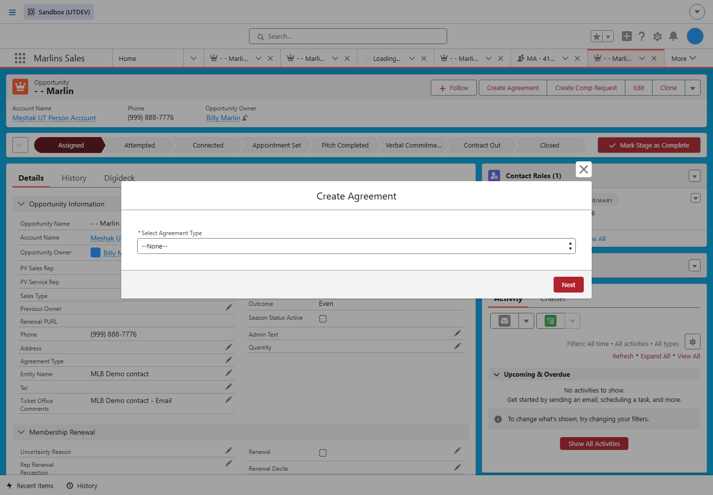
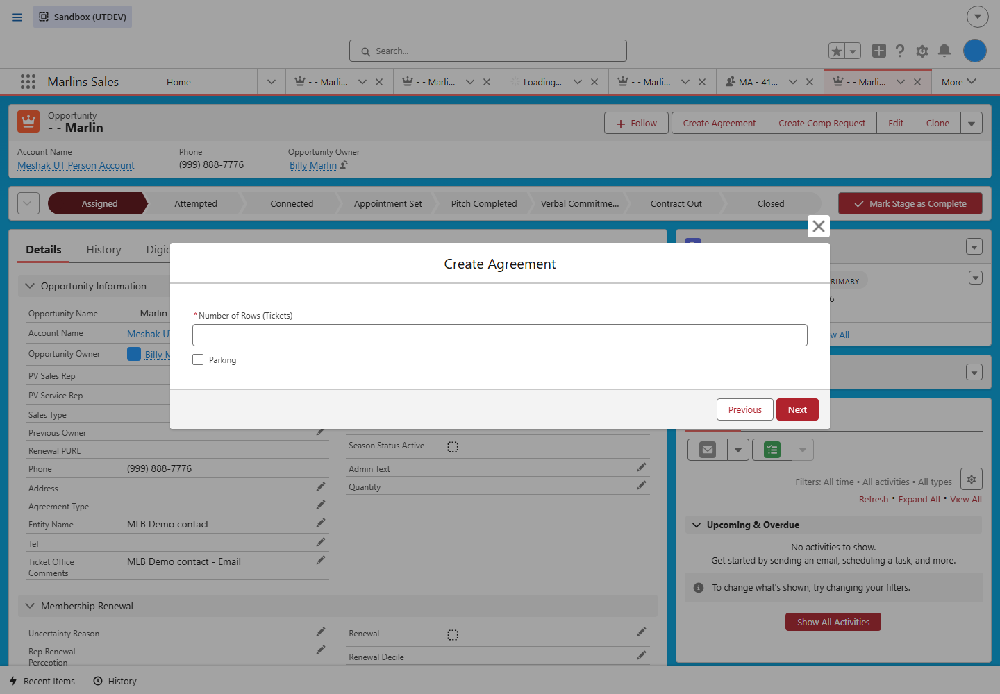

### TC-014-24 — Existing agreement opens prefilled without the type screen
| | |
|---|---|
| **Preconditions** | Logged in as a System Administrator. An Opportunity with a Suite Lease agreement. |
| **Front-end steps** | 1. Click **Edit Agreement**. 2. Check there is no Select Agreement Type screen. 3. Compare the fields with the Suite Lease Details on the Opportunity. 4. Close the window without saving. |
| **Backend check** | Opportunity Suite Lease Details. |
| **Test data** | — |
| **Expected result** | The Suite Lease screen opens directly with the saved values. |
| **Actual result** | |
| **Status** | Pass / Fail |

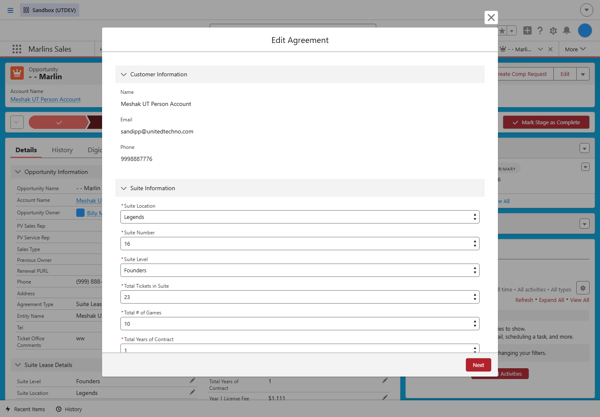
---

## Sign-off
| | |
|---|---|
| **Tester name** | |
| **Test date** | |
| **Test cases passed** | ____ of 24 |
| **Overall result** | Pass / Fail |
| **Comments** | |
| **Signature** | |
