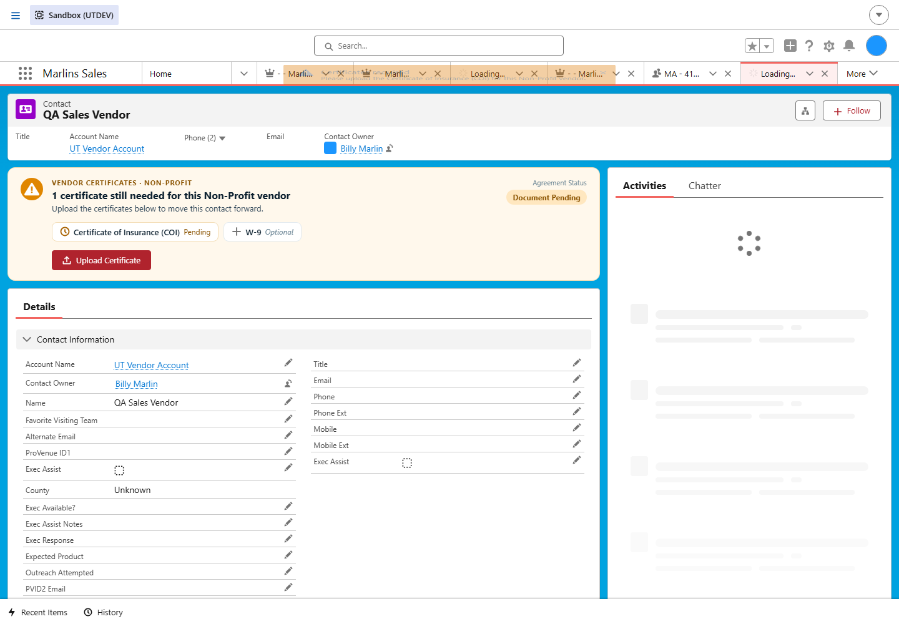
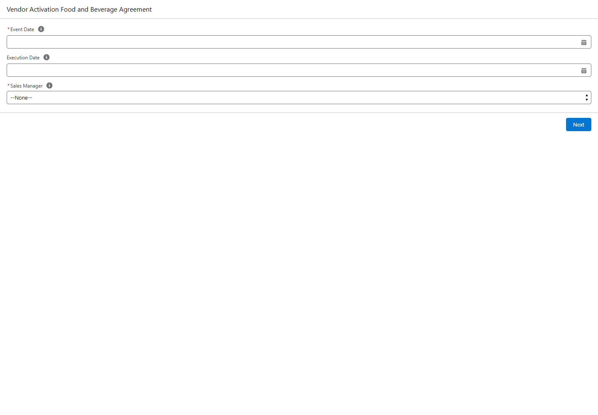

# MTC-002 — Sales Vendor, Sales Manager checkbox and certificate-only attachments

| | |
|---|---|
| **Document** | MTC-002 |
| **Requirements** | REQ-015 · REQ-016 · REQ-017 · REQ-018 |
| **Automated test report** | [ATR-002](../01-Automated-Testing/ATR-002_Sales-Vendor-Sales-Manager-And-Certificate-Attachments.md): 16 of 16 scenarios passed on 2026-10-21 |
| **Environment** | Sandbox (UTDEV), Marlins Sales app |
| **How to use** | Run each test case in order. The **Expected result** is the outcome verified in the automated run. Write what you see in **Actual result** and mark **Status** as Pass or Fail. |

## What is being tested
- **Account:** Sales Vendor Accounts no longer offer "Sales Vendor" as Account Type.
- **Contact:** new **Sales Vendor** record type, available to sales reps, administrators and Sales Managers, with the same certificate and agreement features as Vendor Contact.
- **User:** a **Sales Manager** checkbox decides who is listed as Sales Manager on vendor agreements.
- **Send Agreement:** only certificates uploaded through the Upload Certificate component are attached; files added directly to Files are not.

## Before you start
You need a System Administrator login, a sales rep login (Ticket Sales profile) and a Sales Manager login, a Sales Vendor Account with Type Non-Profit, and a certificate file (PDF) to upload. Delete the test contacts you create when finished.

## Test case summary
| Test ID | Scenario | Expected result | Actual result | Status |
|---|---|---|---|---|
| TC-015-01 | Sales Vendor Account Type values | No "Sales Vendor" in the list | | |
| TC-015-02 | Vendor Account keeps the value | "Sales Vendor" still offered | | |
| TC-016-01 | Create a Sales Vendor contact (sales rep) | Sales Vendor offered and saved | | |
| TC-016-02 | Create a Sales Vendor contact (Sales Manager) | Sales Vendor offered and saved | | |
| TC-016-03 | Status set from certificates | Agreement Status = Document Pending | | |
| TC-016-04 | Certificate banner and upload | Banner with Upload Certificate; upload ticks the certificate | | |
| TC-016-05 | Status follows the agreement | Agreement Status changes to Draft after Send Agreement | | |
| TC-017-01 | Sales Manager list | Only ticked users listed | | |
| TC-017-02 | Untick a Sales Manager | User disappears from the list | | |
| TC-018-01 | Uploaded certificate saved as attachment | "[Category] file" attachment on the Contact | | |
| TC-018-02 | Send Agreement attaches certificates only | Directly added file not attached | | |

---

## Test cases

### TC-015-01 — Sales Vendor Account Type values
| | |
|---|---|
| **Preconditions** | Logged in as a System Administrator. |
| **Front-end steps** | 1. Open a Sales Vendor Account (or click New Account and choose Sales Vendor). 2. Click **Edit** and open the **Type** dropdown. 3. Click **Cancel**. |
| **Backend check** | — |
| **Test data** | — |
| **Expected result** | Type offers Analyst, Competitor, Customer, Integrator, Investor, Partner, Press, Prospect, Reseller, Other, Food and Beverage, Non-Profit, Sales Activation. "Sales Vendor" is not offered. |
| **Actual result** | |
| **Status** | Pass / Fail |

### TC-015-02 — Vendor Account keeps the value
| | |
|---|---|
| **Preconditions** | Logged in as a System Administrator. |
| **Front-end steps** | 1. Open a Vendor Account and click **Edit**. 2. Open the **Type** dropdown. 3. Click **Cancel**. |
| **Backend check** | — |
| **Test data** | — |
| **Expected result** | "Sales Vendor" is still offered on the Vendor record type. |
| **Actual result** | |
| **Status** | Pass / Fail |

### TC-016-01 — Create a Sales Vendor contact (sales rep)
| | |
|---|---|
| **Preconditions** | Logged in as a sales rep (Ticket Sales profile). |
| **Front-end steps** | 1. Contacts → **New**. 2. Choose record type **Sales Vendor**, click **Next**. 3. Enter Last Name and the Sales Vendor Account (Type Non-Profit), click **Save**. |
| **Backend check** | Contact record type = Sales Vendor. |
| **Test data** | Last Name "QA Sales Vendor" |
| **Expected result** | Sales Vendor is offered (not as the default) and the contact saves with the Vendor layout. |
| **Actual result** | |
| **Status** | Pass / Fail |

### TC-016-02 — Create a Sales Vendor contact (Sales Manager)
| | |
|---|---|
| **Preconditions** | Logged in as a Sales Manager. |
| **Front-end steps** | Same as TC-016-01. |
| **Backend check** | Contact record type = Sales Vendor. |
| **Test data** | Last Name "QA Sales Vendor SM" |
| **Expected result** | Sales Vendor is offered and the contact saves. |
| **Actual result** | |
| **Status** | Pass / Fail |

### TC-016-03 — Status set from certificates
| | |
|---|---|
| **Preconditions** | TC-016-01 completed. |
| **Front-end steps** | 1. Open the new Sales Vendor contact. 2. Look at **Agreement Status**. |
| **Backend check** | Agreement Status. |
| **Test data** | — |
| **Expected result** | Agreement Status = **Document Pending**. |
| **Actual result** | |
| **Status** | Pass / Fail |

### TC-016-04 — Certificate banner and upload
| | |
|---|---|
| **Preconditions** | TC-016-01 completed. |
| **Front-end steps** | 1. Open the Sales Vendor contact. 2. Check the **Vendor Certificates** banner shows COI pending and W-9 optional, with **Upload Certificate**. 3. Click **Upload Certificate**, choose COI, upload a PDF and finish. |
| **Backend check** | COI Collected = true; Agreement Status = Document Uploaded. |
| **Test data** | Any PDF |
| **Expected result** | Banner shown with the button; after the upload the COI is collected and the status changes to Document Uploaded. |
| **Actual result** | |
| **Status** | Pass / Fail |

### TC-016-05 — Status follows the agreement
| | |
|---|---|
| **Preconditions** | TC-016-04 completed (Send Agreement visible once the status allows it). |
| **Front-end steps** | 1. On the Sales Vendor contact, use **Create Agreement**, then **Send Agreement**. 2. When the Adobe Sign draft opens, close it without sending. 3. Refresh the contact. |
| **Backend check** | Agreement Status. |
| **Test data** | — |
| **Expected result** | Agreement Status follows the new agreement (Draft). Delete the draft afterwards. |
| **Actual result** | |
| **Status** | Pass / Fail |

### TC-017-01 — Sales Manager list
| | |
|---|---|
| **Preconditions** | Logged in as a System Administrator. A vendor contact where **Create Agreement** is available. |
| **Front-end steps** | 1. Click **Create Agreement** on the contact. 2. Open the **Sales Manager** dropdown. 3. Close the window without saving. |
| **Backend check** | Setup → Users: who has Sales Manager ticked. |
| **Test data** | — |
| **Expected result** | The dropdown lists exactly the active users with Sales Manager ticked (sandbox: Ruben Smith, Billy Marlin). |
| **Actual result** | |
| **Status** | Pass / Fail |

### TC-017-02 — Untick a Sales Manager
| | |
|---|---|
| **Preconditions** | Logged in as a System Administrator. |
| **Front-end steps** | 1. Setup → Users → Ruben Smith → **Edit** → untick **Sales Manager** → Save. 2. Repeat TC-017-01. 3. Tick Sales Manager on Ruben Smith again. |
| **Backend check** | — |
| **Test data** | — |
| **Expected result** | With Ruben unticked, only Billy Marlin is listed. |
| **Actual result** | |
| **Status** | Pass / Fail |

### TC-018-01 — Uploaded certificate saved as attachment
| | |
|---|---|
| **Preconditions** | TC-016-04 completed. |
| **Front-end steps** | 1. Open the contact's **Notes & Attachments** (or Files) related list. 2. Look for the attachment named "[COI] …". |
| **Backend check** | Attachment on the Contact with name starting "[COI]". |
| **Test data** | — |
| **Expected result** | "[COI] <file name>.pdf" is on the contact (it can take a few seconds to appear). |
| **Actual result** | |
| **Status** | Pass / Fail |

### TC-018-02 — Send Agreement attaches certificates only
| | |
|---|---|
| **Preconditions** | A vendor contact with a certificate uploaded through the component, and Send Agreement available. |
| **Front-end steps** | 1. On the contact, use **Files → Upload Files** to add any other file directly. 2. Click **Send Agreement**. 3. In the Adobe Sign draft, check the attached documents. 4. Close the draft without sending and delete it. |
| **Backend check** | Files on the draft agreement. |
| **Test data** | Any extra file |
| **Expected result** | The draft holds the generated agreement and the "[Category]" certificate(s) only. The file added directly is **not** attached. Automated run: generated agreement + "[W-9] walletlicense9021623_3834.pdf" only. |
| **Actual result** | |
| **Status** | Pass / Fail |

---

## Sign-off
| | |
|---|---|
| **Tester name** | |
| **Test date** | |
| **Test cases passed** | ____ of 11 |
| **Overall result** | Pass / Fail |
| **Comments** | |
| **Signature** | |
