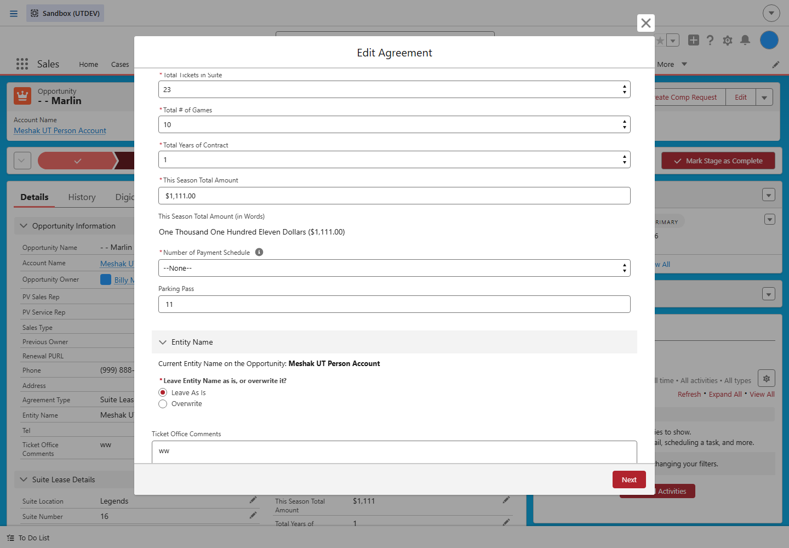
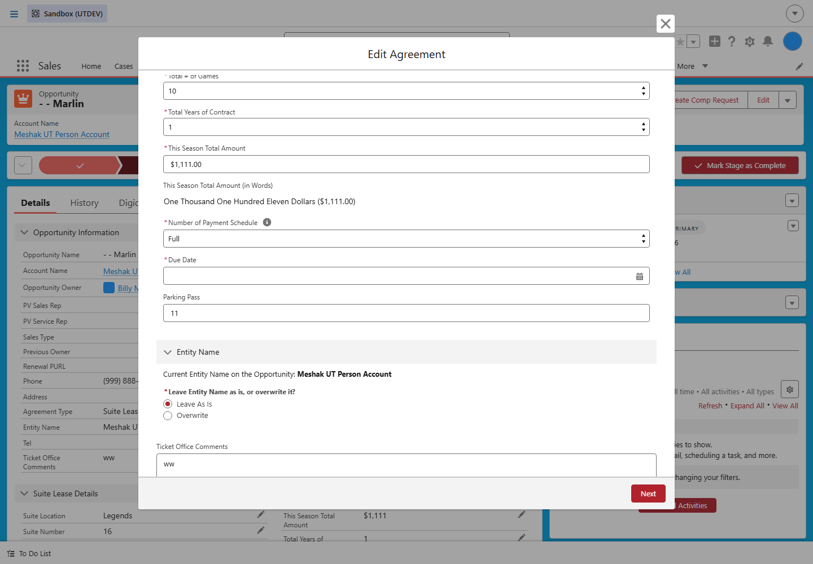
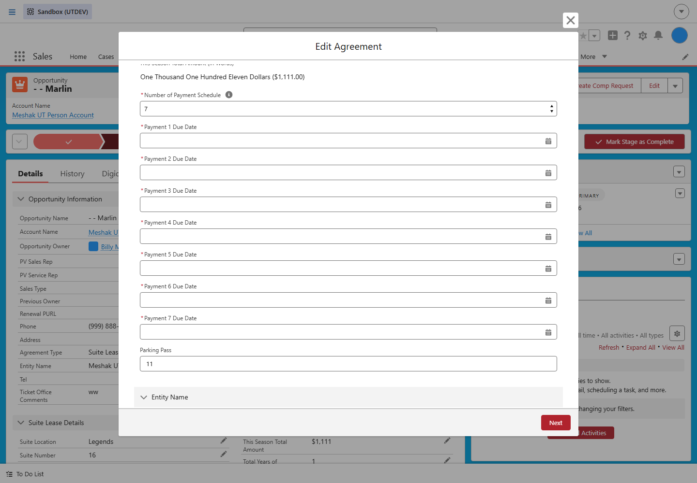
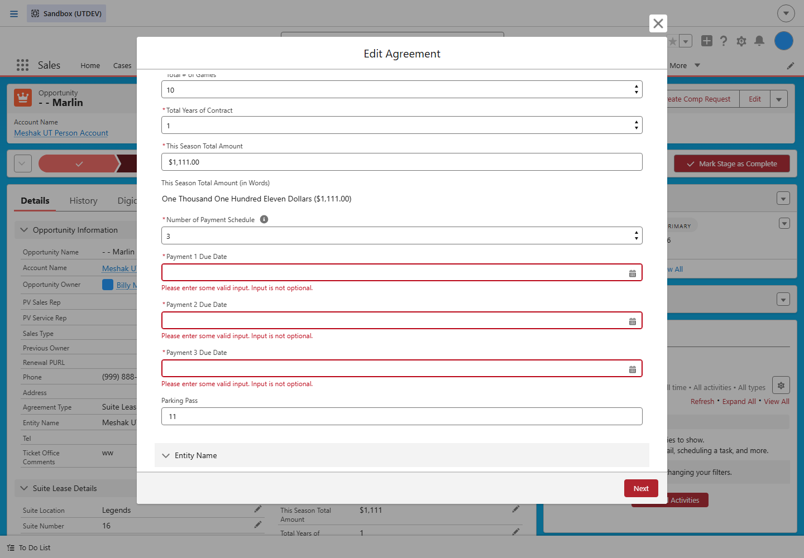
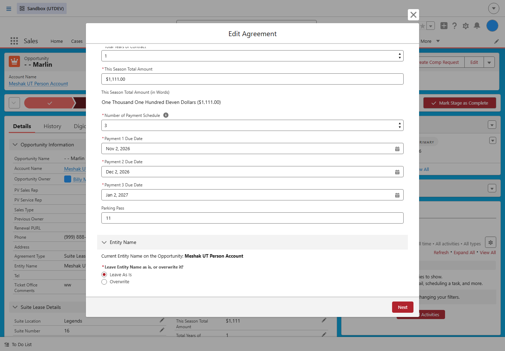
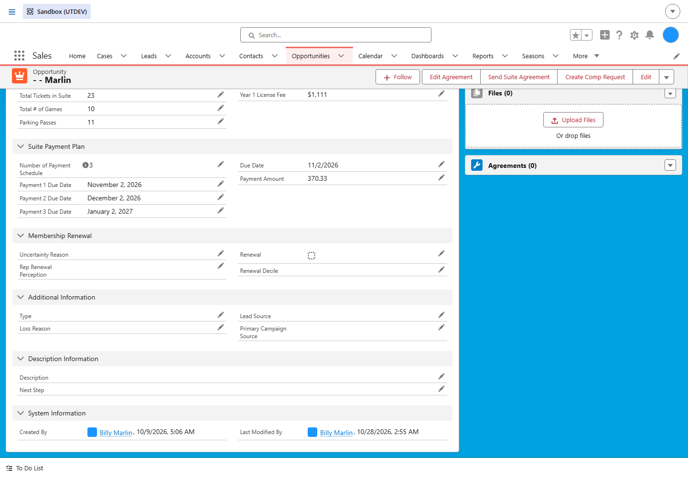
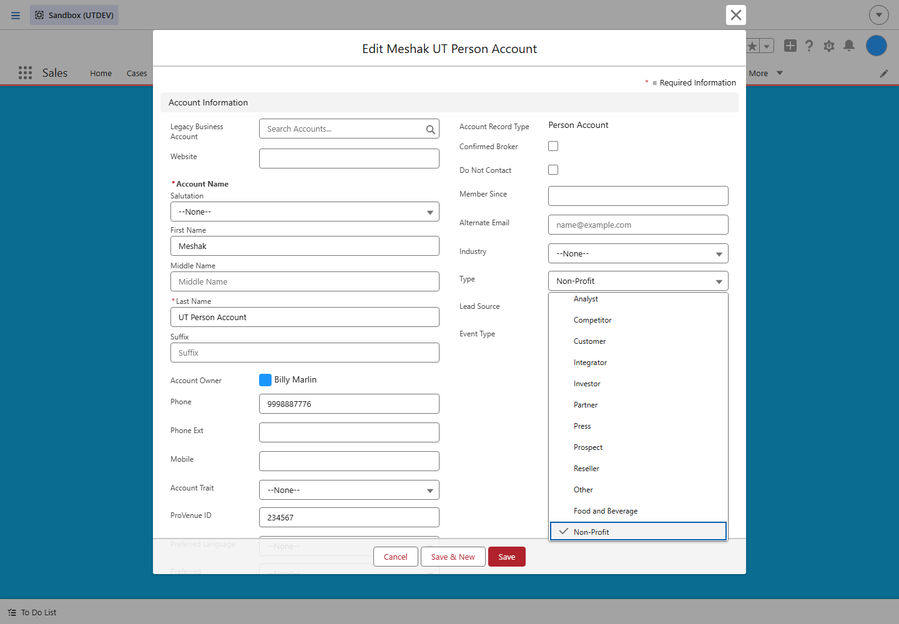

# MTC-003 — Suite Lease payment schedule and Person Account Type values

| | |
|---|---|
| **Document** | MTC-003 |
| **Requirements** | REQ-019 · REQ-020 |
| **Automated test report** | [ATR-003](../01-Automated-Testing/ATR-003_Suite-Lease-Payment-Schedule-And-Person-Account-Type.md): 20 of 20 scenarios passed on 2026-10-28 |
| **Environment** | Sandbox (UTDEV), Sales app |
| **How to use** | Run each test case in order. The **Expected result** is the outcome verified in the automated run. Write what you see in **Actual result** and mark **Status** as Pass or Fail. |

## What is being tested
- **License fees:** Year 1 to Year 5 License Fee can now be edited directly on the Opportunity.
- **Payment schedule:** on the Suite Lease screen of Create / Edit Agreement, the rep picks **Number of Payment Schedule** (Full or 2–12) and enters a due date for each payment. Salesforce calculates one **Payment Amount** and saves the dates written out, for example "November 2, 2026".
- **Opportunity page:** a **Suite Payment Plan** section shows the saved schedule.
- **Person Accounts:** Account Type now offers **Food and Beverage** and **Non-Profit**.

## Before you start
- A System Administrator login and a sales login (Ticket Sales or Sales Manager).
- A **Suite Lease** Opportunity you may change (test record), with This Season Total Amount filled in, for example $1,111.
- A Person Account test record.
- Don't click **Send Suite Agreement** during these tests.

## Test case summary
| Test ID | Scenario | Expected result | Actual result | Status |
|---|---|---|---|---|
| TC-019-01 | Edit Year 1–5 License Fee as a sales user | Saved | | |
| TC-019-02 | Edit a license fee as an administrator | Saved | | |
| TC-019-03 | Manual edit of the schedule fields | Blocked with the agreement message | | |
| TC-019-04 | Save as the flow does | Covered by the automated test | | |
| TC-019-05 | Payment Amount numbers only | Covered by the automated test | | |
| TC-019-06 | Only Full and 2–12 accepted | Covered by the automated test | | |
| TC-019-07 | Bulk 200 records | Covered by the automated test | | |
| TC-019-08 | Number of Payment Schedule field | Required; Full, 2–12 (no 1) | | |
| TC-019-09 | Full shows one Due Date | One required "Due Date" | | |
| TC-019-10 | N payments show N due dates | 2 → 2 dates, 7 → 7, 12 → 12 | | |
| TC-019-11 | Due dates are required | Can't continue with empty dates | | |
| TC-019-12 | Save a 3-payment schedule | Amount 370.33; dates "November 2, 2026" … | | |
| TC-019-13 | Edit Agreement brings it back | Schedule and dates prefilled | | |
| TC-019-14 | Suite Payment Plan section | Only the dates in use shown | | |
| TC-019-15 | Tags in the Adobe templates | 15 tags on each Suite Lease template | | |
| TC-019-16 | Field access | Sales users can see the fields | | |
| TC-019-17 | Field definitions | Covered by the automated test | | |
| TC-020-01 | Person Account Type values | Food and Beverage, Non-Profit offered | | |
| TC-020-02 | Save a Person Account with the value | Saved | | |
| TC-020-03 | Business Account unchanged | Values not offered | | |

---

## Test cases

### TC-019-01 — Edit Year 1–5 License Fee as a sales user
| | |
|---|---|
| **Preconditions** | Logged in as a sales user (Ticket Sales or Sales Manager); a Suite Lease Opportunity you own. |
| **Front-end steps** | 1. Open the Opportunity, section **Suite Lease Details**. 2. Click the pencil next to **Year 1 License Fee**, enter a value; do the same for Year 2–5. 3. Click **Save**. |
| **Backend check** | Year 1–5 License Fee on the record. |
| **Test data** | 1000, 1030, 1060, 1090, 1120 |
| **Expected result** | The record saves without an error and shows the new fees. |
| **Actual result** | |
| **Status** | Pass / Fail |

### TC-019-02 — Edit a license fee as an administrator
| | |
|---|---|
| **Preconditions** | Logged in as a System Administrator. |
| **Front-end steps** | Same as TC-019-01, change Year 3 License Fee only. |
| **Backend check** | Year 3 License Fee. |
| **Test data** | 5000 |
| **Expected result** | Saved. |
| **Actual result** | |
| **Status** | Pass / Fail |

### TC-019-03 — Manual edit of the schedule fields
| | |
|---|---|
| **Preconditions** | A Suite Lease Opportunity with a saved schedule (after TC-019-12). |
| **Front-end steps** | 1. In **Suite Payment Plan**, click the pencil next to **Payment Amount**, change it, click **Save**. 2. Repeat for **Number of Payment Schedule** and **Payment 1 Due Date**. |
| **Backend check** | Values unchanged. |
| **Test data** | Payment Amount 100 |
| **Expected result** | Each save is blocked: "Agreement details can't be edited manually. Please use the Edit Agreement button on the Opportunity." |
| **Actual result** | |
| **Status** | Pass / Fail |

### TC-019-04 to TC-019-07 — Backend rules
| | |
|---|---|
| **Preconditions** | — |
| **Front-end steps** | Covered by the automated test. Optional: in Edit Agreement, check that only Full and 2–12 can be chosen. |
| **Backend check** | ATR-003, scenarios TC-019-04 to 07. |
| **Test data** | — |
| **Expected result** | TC-019-04: the flow-style save stores schedule, amount and dates. TC-019-05: 1250 and 1250.50 accepted; 12a, 1,250, -5, $100, 1250.505 rejected with "Payment Amount can contain numbers only …". TC-019-06: Full, 2–12 accepted; 1, 0, 13 rejected. TC-019-07: 200 records saved / blocked as expected. |
| **Actual result** | |
| **Status** | Pass / Fail |

### TC-019-08 — Number of Payment Schedule field
| | |
|---|---|
| **Preconditions** | Logged in as a System Administrator; the Suite Lease test Opportunity. |
| **Front-end steps** | 1. Click **Edit Agreement**. 2. On the Suite Information screen, find **Number of Payment Schedule** and open the list. |
| **Backend check** | — |
| **Test data** | — |
| **Expected result** | The field is required (red asterisk, with help text). It offers --None--, Full, 2, 3 … 12. "1" is not offered. |
| **Actual result** | |
| **Status** | Pass / Fail |

### TC-019-09 — Full shows one Due Date
| | |
|---|---|
| **Preconditions** | Continue from TC-019-08. |
| **Front-end steps** | Select **Full**. |
| **Backend check** | — |
| **Test data** | Full |
| **Expected result** | One required field labelled **Due Date** appears; no "Payment N Due Date" fields. |
| **Actual result** | |
| **Status** | Pass / Fail |

### TC-019-10 — N payments show N due dates
| | |
|---|---|
| **Preconditions** | Continue from TC-019-09. |
| **Front-end steps** | Select **2**, then **7**, then **12**. |
| **Backend check** | — |
| **Test data** | 2, 7, 12 |
| **Expected result** | 2 → Payment 1–2 Due Date; 7 → Payment 1–7 Due Date; 12 → Payment 1–12 Due Date. All required. |
| **Actual result** | |
| **Status** | Pass / Fail |

### TC-019-11 — Due dates are required
| | |
|---|---|
| **Preconditions** | Continue from TC-019-10. |
| **Front-end steps** | 1. Select **3** and leave the three dates empty. 2. Click **Next**. |
| **Backend check** | The Opportunity is not changed. |
| **Test data** | 3 |
| **Expected result** | The screen stays open; each empty date shows "Please enter some valid input. Input is not optional." |
| **Actual result** | |
| **Status** | Pass / Fail |

### TC-019-12 — Save a 3-payment schedule
| | |
|---|---|
| **Preconditions** | Continue from TC-019-11; This Season Total Amount $1,111. |
| **Front-end steps** | 1. Enter the three dates. 2. Under Entity Name keep **Leave As Is**. 3. Click **Next** until the agreement is saved. |
| **Backend check** | Opportunity: Number of Payment Schedule, Payment Amount, Payment 1–12 Due Date, Due Date. |
| **Test data** | Nov 2, 2026 · Dec 2, 2026 · Jan 2, 2027 |
| **Expected result** | Number of Payment Schedule = 3; Payment Amount = 370.33; Payment 1 Due Date "November 2, 2026", Payment 2 "December 2, 2026", Payment 3 "January 2, 2027"; Payment 4–12 empty; Due Date 11/2/2026. No email is sent. |
| **Actual result** | |
| **Status** | Pass / Fail |

### TC-019-13 — Edit Agreement brings it back
| | |
|---|---|
| **Preconditions** | After TC-019-12. |
| **Front-end steps** | 1. Click **Edit Agreement** again. 2. Look at the payment fields, then close the window with **X** (don't save). |
| **Backend check** | — |
| **Test data** | — |
| **Expected result** | Number of Payment Schedule = 3; Payment 1–3 Due Date show Nov 2, 2026, Dec 2, 2026 and Jan 2, 2027. |
| **Actual result** | |
| **Status** | Pass / Fail |

### TC-019-14 — Suite Payment Plan section
| | |
|---|---|
| **Preconditions** | After TC-019-12. |
| **Front-end steps** | Open the Opportunity and scroll to **Suite Payment Plan** (below Suite Lease Details). |
| **Backend check** | — |
| **Test data** | — |
| **Expected result** | Left: Number of Payment Schedule 3, Payment 1–3 Due Date (written out). Right: Due Date 11/2/2026, Payment Amount 370.33. Payment 4–12 Due Date are not shown. Suite Lease Details shows the suite fields on the left and amounts, years and license fees on the right. |
| **Actual result** | |
| **Status** | Pass / Fail |

### TC-019-15 — Tags in the Adobe templates
| | |
|---|---|
| **Preconditions** | Logged in as a System Administrator. |
| **Front-end steps** | 1. Open Adobe Sign Document Builder, template **Suite Lease Agreement <50k**. 2. Open **Add Salesforce Fields** and look for the payment tags. 3. Repeat for **Suite Lease Agreement Template >50k**. |
| **Backend check** | — |
| **Test data** | — |
| **Expected result** | Both list `{{Opportunity.Number_of_Payment_Plans__c}}`, `{{Opportunity.Payment_Amount__c}}`, `{{Opportunity.Payment_Due_Date_1__c}}` … `{{Opportunity.Payment_Due_Date_12__c}}` and `{{Opportunity.Account.Type}}` (15). |
| **Actual result** | |
| **Status** | Pass / Fail |

### TC-019-16 — Field access
| | |
|---|---|
| **Preconditions** | Logged in as a sales user. |
| **Front-end steps** | Open a Suite Lease Opportunity with a saved schedule. |
| **Backend check** | — |
| **Test data** | — |
| **Expected result** | The Suite Payment Plan section and its values are visible. |
| **Actual result** | |
| **Status** | Pass / Fail |

### TC-019-17 — Field definitions
| | |
|---|---|
| **Preconditions** | — |
| **Front-end steps** | Covered by the automated test. Optional: Setup → Object Manager → Opportunity → Fields & Relationships, search "Payment". |
| **Backend check** | — |
| **Test data** | — |
| **Expected result** | Number of Payment Schedule (Picklist), Payment Amount (Text 18), Payment 1–12 Due Date (Text 30). No "Payment N Amount" or "Formatted" fields. |
| **Actual result** | |
| **Status** | Pass / Fail |

### TC-020-01 — Person Account Type values
| | |
|---|---|
| **Preconditions** | Logged in as a System Administrator; a Person Account test record. |
| **Front-end steps** | 1. Open the Person Account and click **Edit**. 2. Open the **Type** field next to **Industry** (not the first "Type" field near Persona; that is a different field). 3. Click **Cancel**. |
| **Backend check** | — |
| **Test data** | — |
| **Expected result** | Type offers Analyst, Competitor, Customer, Integrator, Investor, Partner, Press, Prospect, Reseller, Other, **Food and Beverage**, **Non-Profit**, Sales Activation. |
| **Actual result** | |
| **Status** | Pass / Fail |

### TC-020-02 — Save a Person Account with the value
| | |
|---|---|
| **Preconditions** | Logged in as a sales user; a Person Account test record. |
| **Front-end steps** | 1. Edit the Person Account, set **Type** (next to Industry) to **Food and Beverage**, click **Save**. 2. Repeat with **Non-Profit**. 3. Set it back to its original value. |
| **Backend check** | Account Type on the record. |
| **Test data** | Food and Beverage; Non-Profit |
| **Expected result** | Both save without an error. |
| **Actual result** | |
| **Status** | Pass / Fail |

### TC-020-03 — Business Account unchanged
| | |
|---|---|
| **Preconditions** | A Business Account. |
| **Front-end steps** | Edit the Business Account, open **Type**, click **Cancel**. |
| **Backend check** | — |
| **Test data** | — |
| **Expected result** | Food and Beverage and Non-Profit are not offered (unchanged). |
| **Actual result** | |
| **Status** | Pass / Fail |

---

## Sign-off
| | |
|---|---|
| **Tester name** | |
| **Test date** | |
| **Test cases passed** | ____ of 20 |
| **Overall result** | Pass / Fail |
| **Comments** | |
| **Signature** | |
