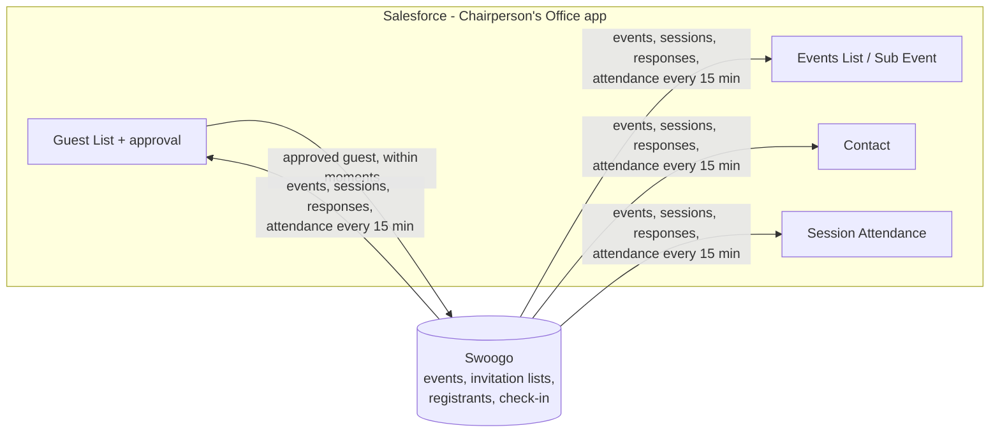

# 01 · Project Overview

## Purpose

Qatar Museums' Chairperson's Office manages VIP guest lists for its events in Salesforce and runs invitations, registration and on-site check-in in Swoogo. The integration lets the office decide **who is invited** in Salesforce (with a formal approval) while Swoogo handles **the invitation itself**, and brings every response back into Salesforce so guest records stay complete without re-keying.

## Scope

| In scope | Out of scope |
| --- | --- |
| Sync of Swoogo events and sessions into Salesforce | Creating events or sessions from Salesforce |
| Adding guests to an event in Salesforce and approving them | Sending invitation emails (done by Swoogo) |
| Pushing approved guests to Swoogo invitation lists or registrations | Creating Salesforce Contacts from Swoogo registrants (the sync only updates existing Contacts) |
| Syncing back invitation status, registration status, travel and hotel answers, contact details | Real-time sync from Swoogo webhooks (webhooks are logged only) |
| Session registration and attendance (check-in) | |
| Guest reports, PDFs and bio booklets per event | |
| Email alert when a main guest reaches Swoogo | |

## Users and roles

| Role | What they do in Salesforce |
| --- | --- |
| Event team (submitter) | Adds guests to events, submits them for approval, tracks status and reports |
| Level 1 reviewer | Reviews guest details in **Pending Approvals** (Stage 1) |
| Level 2 approver | Chooses the guest tier and approves or rejects (Stage 2) |
| Alert recipient | Receives "New Guest Added in Swoogo" emails at the event's **Alert Email** |
| Administrator | Maintains configuration, schedules the sync, resends failed guests |

In the sandbox, the approval process names `fzuccarini@qm.org.qa` (Level 1) and `faalthani@qm.org.qa` (Level 2) as approvers.

## Systems

## Key concepts

| Term | Meaning |
| --- | --- |
| Event (`Invitation__c`, label **Events List**) | One Swoogo event. Keyed by `External_Event_Id__c` = Swoogo event id |
| Session (`Sub_Event__c`) | One Swoogo session. Keyed by `Sub_Event_ID__c` |
| Guest List (`Guest_List__c`) | One person's place on one event; links a Contact to an event |
| Main guest / accompanying guest | Accompanying (+1) guests have `Main_Guest__c` set to the main guest's Guest List record |
| Guest Tiers | Confirmed tier (e.g. Local, International Hosted, International Non-Hosted). Must equal a Swoogo invitation list name |
| Swoogo Push Status | Result message of pushing the guest to Swoogo |

## Current state (sandbox, 2026-10-15)

| Item | Value |
| --- | --- |
| Events (`Invitation__c`) | 48 |
| Sessions (`Sub_Event__c`) | 1,938 |
| Guest List records | 1,208 |
| Session Attendance records | 7,551 |
| Log rows (`Webhook_Log_c__c`) | 22,238 |
| Scheduled Swoogo sync jobs | **None scheduled** |
| Last successful sync | 2026-08-25 19:15 UTC (`Swoogo_Sync_State__c`) |
| Outbound trigger | Enabled (`Enable_Guest_List_Trigger__c = true`) |
| Test event | "End to End Testing" (`a0NAe00000T7QWXMA3`) |

The inbound sync is not running in the sandbox at the moment. Start it with `SwoogoSyncScheduler.scheduleAll();` (see [04-Integration.md](04-Integration.md#operations-runbook)).

## Deliverables produced

- Client user guide: `Salesforce and Swoogo Guest Management - How It Works.doc` (Desktop), with screenshots and step-by-step procedures.
- This knowledge base.
