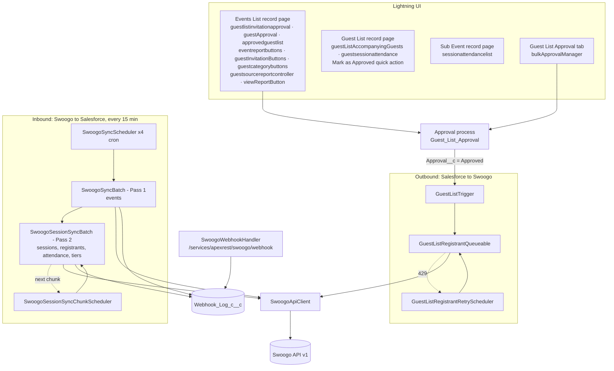
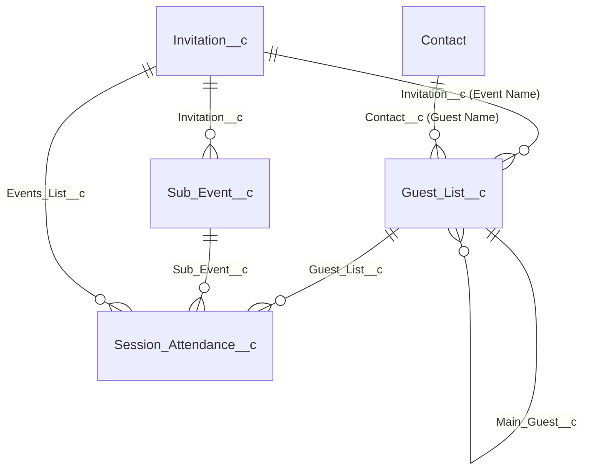

# 02 · Technical Architecture

## Overview

## Data model

### Invitation__c (label: Events List)

| API name | Label | Notes |
| --- | --- | --- |
| `Name` | Event Name | From Swoogo `name` |
| `External_Event_Id__c` | External Event Id | Swoogo event id; the sync key |
| `Event_Start_Date__c` / `Event_End_Date__c` | Event Start Date / End Date | From Swoogo |
| `Location__c` | Location | Swoogo `location`, else `event_venue_type` |
| `Status__c` | Event Status | Draft / Active / Cancelled (mapped) |
| `Swoogo_Updated_At__c` | Swoogo Updated At | Swoogo `updated_at` (text) |
| `Alert_Email__c` | Alert Email | Email field; recipient of "New Guest Added in Swoogo" |
| `Accompanying_Guest_Approval_Required__c` | Accompanying Guest Approval Required | Checkbox, default false |

### Sub_Event__c (label: Sub Event)

| API name | Label | Notes |
| --- | --- | --- |
| `Sub_Event_ID__c` | Sub Event ID | Swoogo session id; sync key (with `Invitation__c`) |
| `Sub_Event_Name__c` | Sub Event Name | |
| `Date__c` | Date | Swoogo `date` |
| `Start_DateTime__c` / `End_DateTime__c` | Start / End Date Time | `date` + `start_time` / `end_time` |
| `Description__c` | Description | HTML stripped |
| `Swoogo_Updated_At__c` | Swoogo Updated At | |

### Guest_List__c (label: Guest List)

| API name | Label | Notes |
| --- | --- | --- |
| `Contact__c` | Guest Name | Required lookup to Contact |
| `Invitation__c` | Event Name | Lookup to Events List |
| `Main_Guest__c` | Main Guest | Set on accompanying guests |
| `Approval__c` | Approval Status | Blank / Pending / Approved / Rejected |
| `Guest_Tier_Recommendations__c` | Guest Tier Recommendations | Local / International Hosted / International Non-Hosted |
| `Guest_Tiers__c` | Guest Tiers | Confirmed tier; must match a Swoogo invitation list name |
| `Invitation_Tier__c` | Invitation Tier | Swoogo invitation list the contact is currently on (inbound) |
| `Invitation_Status__c` | Invitation Status | Bounced Email / No Response / Visited / Accepted / Declined (inbound) |
| `RSVP__c` | Registration Status | Swoogo `registration_status`, first letter capitalised |
| `Swoogo_Registrant_Id__c` | Swoogo Registrant Id | Swoogo registrant id; key for attendance sync |
| `Swoogo_Push_Status__c` | Swoogo Push Status | Outbound result message |
| `Import_from_Swoogo__c` | Import from Swoogo | True = loaded from Swoogo; main guests with this ticked are never pushed |
| `Hotel_Name__c`, `Relationship_to__c` | Hotel Name, Relationship to | From Swoogo custom questions |
| `Inbound_Date_Time__c`, `Outbound_Date_Time__c` | Inbound / Outbound Date & Time | Swoogo I/B and O/B date + time questions combined |
| `Notes__c` | Comments | Approver note from Pending Approvals |
| `Bio__c`, `Guest_Category__c`, `Guest_Sector__c`, `Protocol_Tier__c` | Bio, Guest Category, Guest Sector, Protocol Tier | Copied from Contact by flow |
| `Company__c`, `Title__c` | Company, Title | Sent to Swoogo for accompanying guests |

Record page also shows a **Swoogo Guest ID** field (displays the Contact External Id) and **Group Id**.

### Session_Attendance__c (label: Session Attendance)

| API name | Label | Notes |
| --- | --- | --- |
| `Guest_List__c` | Guest List | |
| `Sub_Event__c` | Sub Event | |
| `Events_List__c` | Events List | |
| `Registered__c` | Registered | Session id is in the registrant's `session_ids` |
| `Attended__c` | Attended | Attendance row has a `check_in_date` |
| `Guest_Name__c`, `Event_Name__c`, `Sub_Event_Name__c`, `Contact__c` | | Filled by flow `Update_Session_Event_Guest_Name` |

### Contact fields used

| API name | Label | Use |
| --- | --- | --- |
| `contact_external_id__c` | Contact External Id | Swoogo contact id; shown as "Contact ID" in components |
| `Email` | Email 1 | Used for outbound lookup/creation and Swoogo email search |
| `Email_Office__c` | Email - 4 | Overwritten with Swoogo registrant email (inbound) |
| `Admin_Email__c`, `Email_2__c`, `Private_Email__c` | | Also searched when matching inbound registrants |
| `Title`, `MobilePhone`, `Phone` | Job Title, Mobile Phone No., Office Phone No. | Updated from Swoogo |

## Configuration

| Item | Type | Purpose |
| --- | --- | --- |
| `SwoogoConfig__mdt` (record `Key_Secret`) | Custom metadata | `ConsumerKey__c`, `ConsumerSecret__c` for OAuth; `EventIds__c` = comma-separated event ids always synced ("pinned"), currently empty |
| `Swoogo_Settings__c` | Hierarchy custom setting | `Enable_Guest_List_Trigger__c` = kill switch for the outbound trigger (org default: true) |
| `Swoogo_Sync_State__c` | Hierarchy custom setting | `Last_Sync_Time__c` (null = next run is FULL), `Last_Error_Time__c` |
| `Webhook_Log_c__c` | Custom object | `Name`, `Raw_Body__c`, `Status__c` (Received / Processed / Processed with errors) |
| Remote Site Setting `Swoogi` | Remote site | Allows callouts to Swoogo |
| Org-wide email `cpcrm@qm.org.qa` (CP CRM) | OWEA | Sender of the alert email |
| Custom label `Report_Folder_Id` | Label | Folder opened by **View Report** |

## Apex classes

### Integration core

| Class | Type | Role |
| --- | --- | --- |
| `SwoogoApiClient` | Service | All HTTP: auth/token cache, pagination, GET/POST/PUT, 401 retry, 429 handling, data models |
| `GuestListTrigger` (trigger) | Trigger | After update on `Guest_List__c`; decides which guests to push; enqueues the queueable |
| `GuestListRegistrantQueueable` | Queueable + callouts | Pushes guests to Swoogo (invitation list or registration + group) |
| `GuestListRegistrantRetryScheduler` | Schedulable | One-off retry for guests that hit HTTP 429 |
| `SwoogoSyncScheduler` | Schedulable | 15-minute entry point; overlap guards; `scheduleAll()` / `abortAll()` helpers |
| `SwoogoSyncBatch` | Batchable<String>, stateful, callouts | Pass 1: events → `Invitation__c`; chains Pass 2 |
| `SwoogoSessionSyncBatch` | Batchable<String>, stateful, callouts | Pass 2: per event sessions, registrants, attendance, invitation tiers; chunks of 6 events |
| `SwoogoSessionSyncChunkScheduler` | Schedulable | Starts the next Pass 2 chunk 1 minute later |
| `SwoogoEventSyncService` | Service | Event upsert + status mapping |
| `SwoogoSubEventSyncService` | Service | Session upsert, HTML strip, date/time build |
| `SwoogoRegistrantSyncService` | Service | Contact updates, registrant-id backfill, RSVP, custom question fields |
| `SwoogoQuestionMapService` | Service | Finds Swoogo custom question attributes (`c_…`) by keyword per event |
| `SwoogoAttendanceSyncService` | Service | Session Attendance upsert |
| `SwoogoInvitationTierSyncService` | Service | Invitation list membership → Invitation Tier / Invitation Status |
| `SwoogoWebhookHandler` | REST `/swoogo/webhook` | Logs Swoogo webhooks; no processing |
| `SwoogoCalloutMock` | Test | Shared HTTP mock for all Swoogo tests |

### UI controllers

| Class | Used by |
| --- | --- |
| `GuestListInvitationController` | LWC `guestlistinvitationapproval` (submit for approval) |
| `BulkApprovalController` | LWC `bulkApprovalManager` (Pending Approvals) |
| `GuestListRelatedListController` | LWC `guestApproval` (Guest List panel) |
| `ApprovedGuestListController` | LWC `approvedguestlist` |
| `SessionAttendanceController` | Session attendance list |

### Legacy or unused (see [05](05-Known-Issues-and-Risks.md))

`SwoogoEventService` (REST `/swoogo/events`), `SwoogoRegistrationService` (REST `/swoogo/registrations`), `SwoogoSessionSyncContinuation`, `SwoogoContactFieldMapService`, `SwoogoEventProcessorQueueable` (empty), `Swoogoeventsyncqueueable` (empty), `GuestListSwoogoPushEmailHandler` (empty), `AbortSwoogoJobsBatch` (manual admin tool), `GuestListApprovalController` and `GuestApprovalController` (commented out).

## Lightning components

| Component | Placement | Purpose |
| --- | --- | --- |
| `guestlistinvitationapproval` | Events List page | **Submit Guest Lists For Approval** modal |
| `guestApproval` | Events List page | Guest List panel: all guests, filters, **+ New Guest**, HE notes |
| `approvedguestlist` | Events List page | Approved guests only |
| `guestsourcereportcontroller` | Events List page | Summary tables: source/tier × invitation/registration status, with definitions |
| `eventreportbuttons` | Events List page | **Event List Reports**: 10 standard reports + Generate All |
| `guestInvitationButtons` / `guestInvitationReport` | Events List page / tab | Guest Invitation Report (Guest Tiers + Invitation Status), PDF |
| `guestcategorybuttons` / `guestcategoryreport` | Events List page / tab | Guest Registration Report (Guest Tiers + Registration Status), PDF |
| `viewReportButton` | Events List page | Opens report folder |
| `guestListAccompanyingGuests` | Guest List page | Accompanying Guests panel with **+ New** |
| `guestsessionattendance` | Guest List page | Sub Event Attendance for the guest |
| `sessionattendancelist` | Sub Event page | Sub Event Attendance for the session |
| `bulkApprovalManager` | **Guest List Approval** tab | Pending Approvals: Stage 1 Review, Stage 2 Approve/Reject, bulk actions |

## Flows (active)

| Flow | Trigger | What it does |
| --- | --- | --- |
| `Guest_list_Approval` | Screen flow, quick action **Mark as Approved** | Sets `Approval__c = Approved` directly (no approval process) |
| `Guest_List_Tier_Update` | Guest List after save | Accompanying guest with blank Guest Tiers gets the main guest's Guest Tiers |
| `Update_Guest_List` | Guest List before create | Accompanying guest gets the main guest's Event Name |
| `Update_Guestlist_from_Contact` | Guest List after save (new or Contact changed) | Copies Bio, Category, Sector, Protocol Tier from Contact |
| `Update_Event_in_guest_list` | Guest List before save | Copies event fields from Session; entry condition questionable |
| `Send_email_for_guest_creation_in_swoogo` | Guest List after update | Push status changed to Success, main guest, Alert Email set → HTML email "New Guest Added in Swoogo" |
| `Update_Session_Event_Guest_Name` | Session Attendance after save | Fills name/lookup helper fields |
| `Add_Main_Contacts` | Screen flow on Contact | Links Contacts to a main Contact (not Swoogo) |

## Approval process: `Guest_List__c.Guest_List_Approval`

| Item | Setting |
| --- | --- |
| Entry criteria | None |
| Submitter | Record owner (submitted in code by `GuestListInvitationController`) |
| Steps | Level 1 (`fzuccarini@qm.org.qa`), Level 2 (`faalthani@qm.org.qa`) |
| Final approval | Field update `Guest_Approved`: `Approval__c = Approved` |
| Final rejection | Field update `Status_Rejected`: `Approval__c = Rejected` |
| On submit | No actions in the process; the LWC sets `Approval__c = Pending` |
| Recall | Not allowed |
| Record lock | Locked while pending; unlocked after decision |
| Email alerts | None configured |

## Visualforce pages

| Page | Output |
| --- | --- |
| `GuestInvitationReportPdf` | PDF of Guest Invitation Report |
| `GuestCategoryReportPdf` | PDF of Guest Registration Report |
| `EventGuestBioRedirect` → `EventGuestBio` | Bio booklet PDF (button **Generate Bio Booklet**) |
| `InvitationPDF` | One page per guest with background and photo (launch point not found) |
| `GuestListEventHistoryPage` | All events for the same Contact |

## Scheduling and async model

| Job | Name pattern | When |
| --- | --- | --- |
| `SwoogoSyncScheduler` | `SwoogoSync_00`, `_15`, `_30`, `_45` | Every 15 min (cron `0 0/15/30/45 * * * ?`) |
| `SwoogoSessionSyncChunkScheduler` | `SwoogoP2Chunk-<epoch ms>` | One-off, 1 min after a Pass 2 chunk finishes |
| `GuestListRegistrantRetryScheduler` | `GuestListRetry-<epoch ms>` | One-off, after Swoogo's rate-limit reset + 15 s |
| `GuestListRegistrantQueueable` | Queueable | Enqueued by the trigger on approval |

Overlap guard: `SwoogoSyncScheduler` skips a tick if `SwoogoSyncBatch` or `SwoogoSessionSyncBatch` is Queued/Processing/Holding/Preparing, or a `SwoogoP2Chunk%` CronTrigger is not `DELETED`.

## Governor-limit design

- Batches run with scope size 1 (one event per execute) to stay within 100 callouts per transaction.
- `SwoogoApiClient` stops paginating at 93 callouts (`MAX_CALLOUTS - 5`) and returns what it has.
- Pass 2 does all callouts first, then all DML, per event (no callout after DML).
- Pass 2 processes 6 events per chunk to spread load across Swoogo's rate-limit window; constructor de-duplicates event ids and caps at 5,000.
- Pagination stops on Swoogo `_meta.pageCount`, not on page size (Swoogo returns 20 per page on some endpoints even when 50 is requested).
