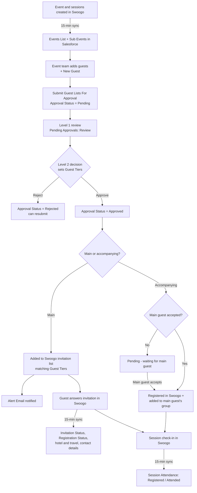

# 03 · Business Process

End-to-end flow from an event being created in Swoogo to guests checking in at sessions. Field names are the labels users see; API names are in [02](02-Technical-Architecture.md).

## 1. Event setup

1. Create the event and its sessions in Swoogo.
2. In the Swoogo event, create invitation lists named exactly like the Guest Tiers values (Local, International Hosted, International Non-Hosted). Name matching ignores case and leading/trailing spaces.
3. Within 15 minutes the event appears in Salesforce as an **Events List** record, with sessions as **Sub Event** records.
4. On the event, set:
   - **Alert Email**: who receives "New Guest Added in Swoogo" (one address).
   - **Accompanying Guest Approval Required**: whether +1 guests go through approval (section 4).
5. For hotel and travel answers to sync, Swoogo question names must contain keywords such as "Hotel", "Relationship", "I/B Date", "I/B Time", "O/B Date", "O/B Time" (full list in [04](04-Integration.md#custom-questions-question-map)).

New events that are already deleted, archived or closed in Swoogo are not created in Salesforce. Existing events that become deleted, archived or closed are set to **Cancelled**.

## 2. Adding a main guest

1. On the event page, Guest List panel → **+ New Guest**.
2. Choose **Guest Name** (Contact, must have **Email 1**) and **Guest Tier Recommendations**. Event Name is set automatically.
3. Flow copies **Bio**, **Guest Category**, **Guest Sector**, **Protocol Tier** from the Contact.

## 3. Approval (two levels)

| Step | Who | Where | Result |
| --- | --- | --- | --- |
| Submit | Event team | Events List page → **Submit Guest Lists For Approval** | Approval Status = **Pending**; record locked |
| Level 1 | Reviewer | **Guest List Approval** tab → Stage 1 → **Review** | Moves to Stage 2 |
| Level 2 | Approver | Stage 2: pick Guest Tier Recommendation → **Approve** / **Reject** | Approve: Guest Tiers set, Approval Status = **Approved**. Reject: **Rejected** |

- Submit window offers guests whose Approval Status is not Approved/Pending and who are not already in an approval. Rejected and blank guests can be resubmitted.
- Bulk: **Select all** + **Approve All** / **Reject All**; batches of 10. A note in the confirm window is saved to **Comments** and used as the approval comment.
- Stage 2 writes the chosen tier to **Guest Tiers** before approving; if that save fails, the request is not approved.
- Recall is not allowed.
- **Mark as Approved** (button on every Guest List record) sets Approval Status = Approved immediately, bypassing both levels.

## 4. Accompanying (+1) guests

1. On the main guest's Guest List record, **Accompanying Guests** panel → **+ New** → choose Guest Name.
2. Flows set **Main Guest** and **Event Name**, and copy the main guest's **Guest Tiers** if blank.
3. Approval depends on the event's **Accompanying Guest Approval Required**:

| | Ticked | Not ticked |
| --- | --- | --- |
| Submit window | Accompanying guests selectable | Shown read-only under the main guest |
| How approved | Two-level approval | **Mark as Approved** on the accompanying guest's record |
| Sent to Swoogo | When Approved and main guest's Invitation Status = Accepted | Same |

4. When an accompanying guest is approved:
   - Main guest already **Accepted** → pushed immediately.
   - Otherwise → Swoogo Push Status = *Pending - waiting for main guest invitation acceptance*. When the main guest's Invitation Status changes to Accepted (via sync), every approved accompanying guest without a Success status is pushed.
5. In Swoogo the accompanying guest is registered directly (registration type = Guest Tiers; created if missing) and added to the group whose id is the main guest's **Swoogo Registrant Id**.

An accompanying guest whose box is unticked and who is never marked approved stays in Salesforce only.

## 5. Push to Swoogo and notification

- Main guest: contact found or created in Swoogo, added to the invitation list matching Guest Tiers. Status *Success - Added to invitation list "<list>"*.
- Accompanying guest: status *Success - Registered and added to group <id>*.
- Main guests marked **Import from Swoogo** are never pushed.
- On a main guest's Success, an email **New Guest Added in Swoogo** goes from CP CRM (`cpcrm@qm.org.qa`) to the event's **Alert Email**, showing guest name, email, Guest Tier, event and a **Click Here to View Record** button. Not sent for accompanying guests, failures, or when Alert Email is empty.

## 6. Guest response and registration (inbound)

Every 15 minutes, for every event:

| Swoogo activity | Salesforce result |
| --- | --- |
| Contact responds to invitation | **Invitation Status** (Bounced Email / No Response / Visited / Accepted / Declined) |
| Contact moved between invitation lists | **Invitation Tier** |
| Registration status changes | **Registration Status** |
| Registration questions answered | **Hotel Name**, **Relationship to**, **Inbound/Outbound Date & Time** |
| Contact details change | Contact name, Job Title, phones, **Email - 4**; **Contact External Id** if empty |
| Registrant created directly in Swoogo | Linked only if a Guest List already exists for that Contact + event (no records created) |

## 7. Sessions and attendance

- Registered for a session in Swoogo → **Registered = Yes** on Session Attendance.
- Checked in → **Attended = Yes**.
- Views: **Sub Event Attendance** panel on the guest record (with totals) and on the session record.

## 8. Reporting

| Report | Where | Filters |
| --- | --- | --- |
| Summary tables + definitions | Events List page, left column | Guest source and tier by invitation status and registration status |
| Event List Reports | Events List page | 10 reports: Confirmed / Declined / No Response / Visited / Canceled × International / Local; **Generate All** |
| Guest Invitation Report (+ PDF) | Events List page panel / tab | Guest Tiers + Invitation Status (blank values excluded) |
| Guest Registration Report (+ PDF) | Events List page panel / tab | Guest Tiers + Registration Status (blank values excluded) |
| Bio booklet PDF | **Generate Bio Booklet** button | All guests of the event |

## 9. Exception handling (business view)

| Swoogo Push Status | Action |
| --- | --- |
| *Retry Pending …* | None; retried automatically after Swoogo's rate-limit window |
| *Failed - No event ID found* | Admin: event has no External Event Id |
| *Failed - No contact/email found* | Add Email 1, then admin resends |
| *Failed - No Guest Tier set* | Set Guest Tiers, then admin resends |
| *Failed - Could not resolve/create Swoogo contact* | Check name/email; admin investigates |
| *Failed - WARNING: no invitation list matches Guest Tier …* | Create the list in Swoogo or fix Guest Tiers, then resend |
| *Failed - Main guest has no Swoogo_Registrant_Id__c yet …* | Wait for main guest's registration to sync, then resend |
| *Failed - direct registration/group error: …* | Admin investigates |

"Resend" = make Approval Status change to Approved again (set to another value, then Approved), which fires the trigger. Guests already at a Success status are skipped.
