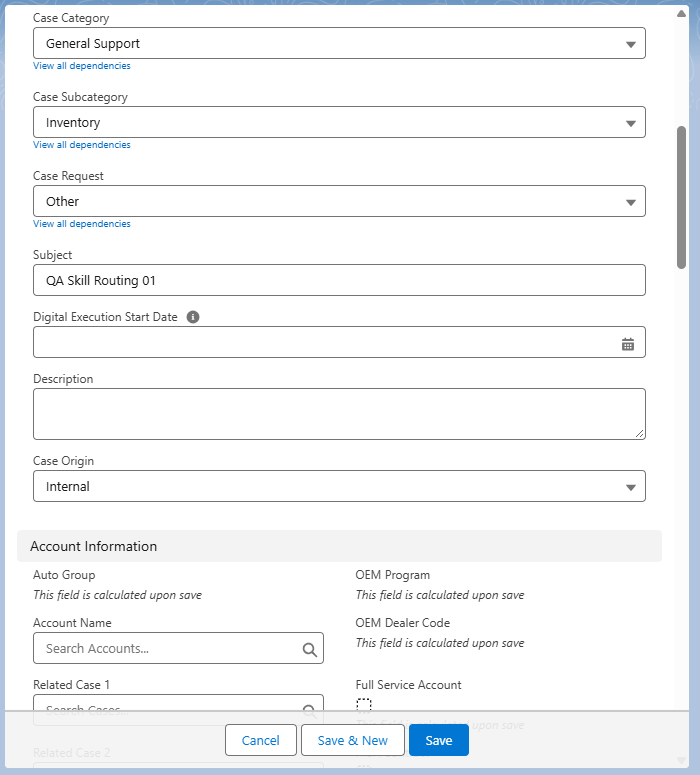
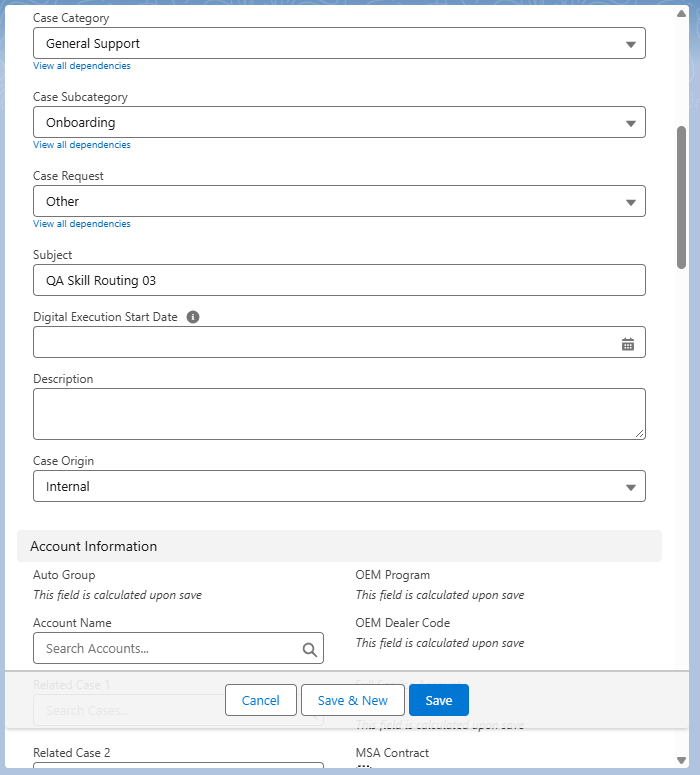
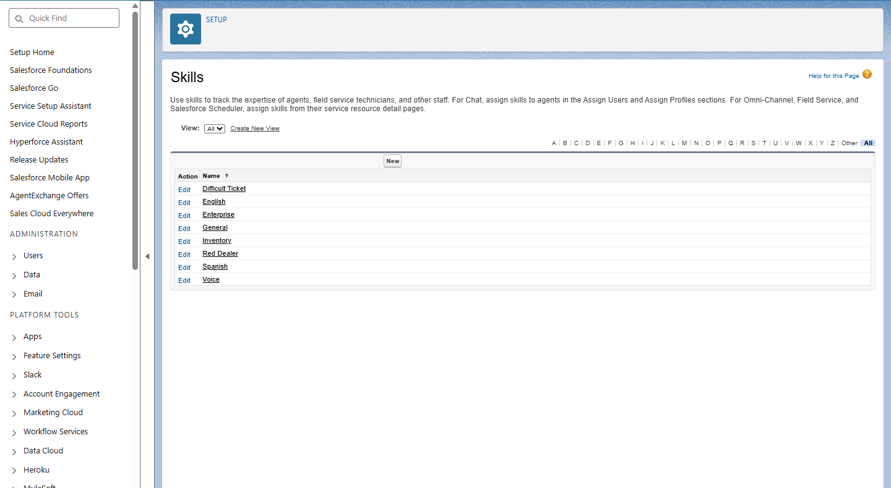
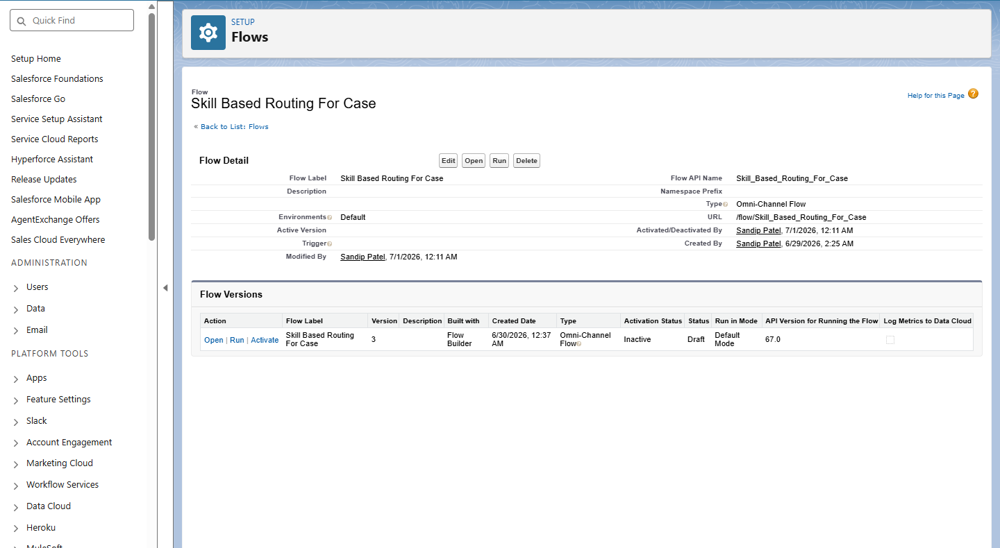
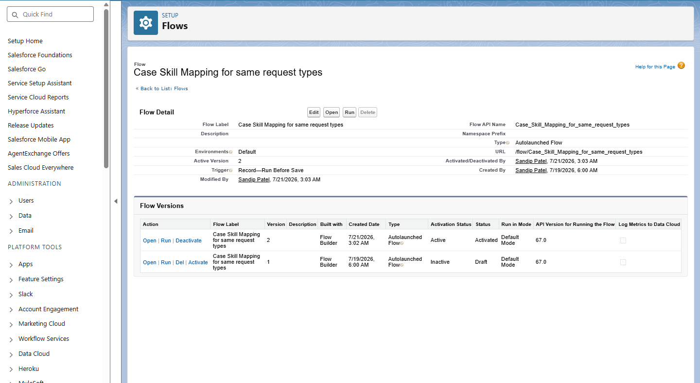
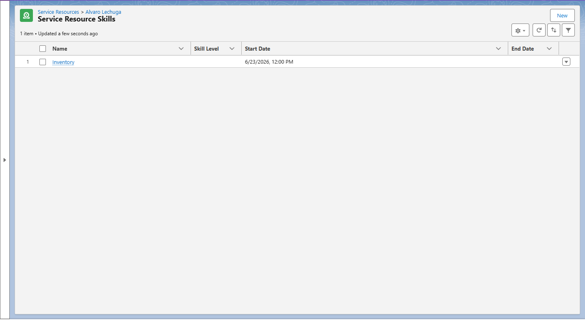

# MTC-001 — Case skill-based routing

| | |
|---|---|
| **Document** | MTC-001 |
| **Requirement** | [REQ-001](../../03-Requirements/REQ-001_Case-Skill-Based-Routing.md) |
| **Automated test report** | [ATR-001](../01-Automated-Testing/ATR-001_Case-Skill-Based-Routing.md): 14 of 14 scenarios passed on 2026-10-22 |
| **Environment** | Sandbox (Fullsandbox), Cases tab |
| **How to use** | Run each test case in order. The **Expected result** is the outcome verified in the automated run. Write what you see in **Actual result** and mark **Status** as Pass or Fail. |

## What is being tested
- When a Case with Case Category **General Support** is saved, Salesforce fills in the **Routing Skill** field from the Case Subcategory and Case Request.
- **Routing Skill = Inventory:** Inventory + Other, and Inventory + VDV Issue.
- **Routing Skill = General:** Onboarding + Other, and Websites - Apollo Apps + VDV Issue.
- **Routing Skill stays blank** for every other combination.
- **Not live in this sandbox:** Routing Skill is the field used to route Cases to agents with the matching Omni-Channel skill. That routing step is
  switched off, so Cases are **not** offered to agents by skill (see TC-001-13 and [CON-001](../../05-Conflicts/CON-001_Case-Skill-Router-Inactive.md)).

## Before you start
You need:
- A System Administrator login, and a General Support agent login.
- An Account to link the test Cases to.

Screenshots show each form filled in **before Save**; Routing Skill is not on the New Case form, because it is filled when the Case is saved.
Saving a Case runs the normal Case automation, such as owner assignment and notifications to the Case owner. Use clearly named test Cases
(Subject starting **"QA Skill Routing"**) and delete them when you finish.

If **Routing Skill** is not on your Case page, check it from a Cases list view with the Routing Skill column added, or ask an administrator
to show it on the page.

## Test case summary
| Test ID | Scenario | Expected result | Actual result | Status |
|---|---|---|---|---|
| TC-001-01 | Inventory + Other | Routing Skill = Inventory | | |
| TC-001-02 | Inventory + VDV Issue | Routing Skill = Inventory | | |
| TC-001-03 | Onboarding + Other | Routing Skill = General | | |
| TC-001-04 | Websites - Apollo Apps + VDV Issue | Routing Skill = General | | |
| TC-001-05 | Unmapped combinations | Routing Skill blank | | |
| TC-001-06 | Edit a Case to a mapped combination | Routing Skill filled on save (General) | | |
| TC-001-07 | Edit a Case to an unmapped combination | Routing Skill keeps its old value (Inventory) | | |
| TC-001-08 | Bulk: 200 Cases | Covered by the automated test | | |
| TC-001-09 | Case created by a General Support agent | Routing Skill = General | | |
| TC-001-10 | Skills exist | General and Inventory skills listed | | |
| TC-001-13 | Omni-Channel routing by skill | Not routed by skill (router switched off) | | |
| TC-001-14 | Agents hold the skills | Agents listed under General and Inventory | | |

TC-001-11 and TC-001-12 are backend-only checks of the automated run (nothing left in the org; mapping Flow active). They are not repeated manually.

---

## Test cases

### TC-001-01 — Inventory + Other
| | |
|---|---|
| **Preconditions** | Logged in as a System Administrator. |
| **Front-end steps** | 1. Open the **Cases** tab and click **New**. 2. If asked for a record type, choose **Master Record Type** and click **Next**. 3. Enter Subject **"QA Skill Routing 01"**, choose the test Account, and set: &nbsp;&nbsp;• **Case Category** = General Support &nbsp;&nbsp;• **Case Subcategory** = Inventory &nbsp;&nbsp;• **Case Request** = Other 4. Click **Save**. 5. On the saved Case, find **Routing Skill**. |
| **Backend check** | Case → Routing Skill. |
| **Test data** | Category General Support · Subcategory Inventory · Request Other |
| **Expected result** | Routing Skill = **Inventory**. |
| **Actual result** | |
| **Status** | Pass / Fail |

### TC-001-02 — Inventory + VDV Issue
| | |
|---|---|
| **Preconditions** | Logged in as a System Administrator. |
| **Front-end steps** | Same as TC-001-01, with Subject **"QA Skill Routing 02"**, **Case Subcategory** = Inventory and **Case Request** = VDV Issue. |
| **Backend check** | Case → Routing Skill. |
| **Test data** | General Support · Inventory · VDV Issue |
| **Expected result** | Routing Skill = **Inventory**. |
| **Actual result** | |
| **Status** | Pass / Fail |

### TC-001-03 — Onboarding + Other
| | |
|---|---|
| **Preconditions** | Logged in as a System Administrator. |
| **Front-end steps** | Same as TC-001-01, with Subject **"QA Skill Routing 03"**, **Case Subcategory** = Onboarding and **Case Request** = Other. |
| **Backend check** | Case → Routing Skill. |
| **Test data** | General Support · Onboarding · Other |
| **Expected result** | Routing Skill = **General**. |
| **Actual result** | |
| **Status** | Pass / Fail |

### TC-001-04 — Websites - Apollo Apps + VDV Issue
| | |
|---|---|
| **Preconditions** | Logged in as a System Administrator. |
| **Front-end steps** | Same as TC-001-01, with Subject **"QA Skill Routing 04"**, **Case Subcategory** = Websites - Apollo Apps and **Case Request** = VDV Issue. |
| **Backend check** | Case → Routing Skill. |
| **Test data** | General Support · Websites - Apollo Apps · VDV Issue |
| **Expected result** | Routing Skill = **General**. |
| **Actual result** | |
| **Status** | Pass / Fail |

### TC-001-05 — Unmapped combinations
| | |
|---|---|
| **Preconditions** | Logged in as a System Administrator. |
| **Front-end steps** | 1. Create a Case as in TC-001-01 with Subject **"QA Skill Routing 05a"**, **Case Subcategory** = Inventory, **Case Request** = Feed Export Issue. Save. 2. Create a second Case, Subject **"QA Skill Routing 05b"**, **Case Subcategory** = Websites - Apollo Apps, **Case Request** = VDV Setup. Save. 3. Check **Routing Skill** on both. |
| **Backend check** | Case → Routing Skill on both Cases. |
| **Test data** | Inventory · Feed Export Issue; Websites - Apollo Apps · VDV Setup |
| **Expected result** | Routing Skill is **blank** on both Cases. |
| **Actual result** | |
| **Status** | Pass / Fail |

### TC-001-06 — Edit a Case to a mapped combination
| | |
|---|---|
| **Preconditions** | TC-001-05 completed (Case "QA Skill Routing 05a" has a blank Routing Skill). |
| **Front-end steps** | 1. Open **"QA Skill Routing 05a"** and click **Edit**. 2. Change **Case Subcategory** to Onboarding and **Case Request** to Other. 3. Click **Save** and check **Routing Skill**. |
| **Backend check** | Case → Routing Skill. |
| **Test data** | Onboarding · Other |
| **Expected result** | Routing Skill changes from blank to **General**. |
| **Actual result** | |
| **Status** | Pass / Fail |

### TC-001-07 — Edit a Case to an unmapped combination
| | |
|---|---|
| **Preconditions** | TC-001-01 completed (Case "QA Skill Routing 01" has Routing Skill = Inventory). |
| **Front-end steps** | 1. Open **"QA Skill Routing 01"** and click **Edit**. 2. Change **Case Request** to Feed Export Issue (Subcategory stays Inventory). 3. Click **Save** and check **Routing Skill**. |
| **Backend check** | Case → Routing Skill. |
| **Test data** | Inventory · Feed Export Issue |
| **Expected result** | Routing Skill **stays Inventory**. The automation does not clear the skill when the combination no longer matches. This is current behaviour, noted in CON-001. |
| **Actual result** | |
| **Status** | Pass / Fail |

### TC-001-08 — Bulk: 200 Cases
| | |
|---|---|
| **Preconditions** | — |
| **Front-end steps** | Covered by the automated test. Optional manual method: create several Cases quickly through Data Loader or a list view, using the four mapped combinations. |
| **Backend check** | Report or list view of the test Cases, grouped by Routing Skill. |
| **Test data** | 50 Cases of each mapped combination (automated run) |
| **Expected result** | 100 Inventory and 100 General, none wrong (automated run). |
| **Actual result** | Covered by the automated test (ATR-001). |
| **Status** | Pass / Fail |

### TC-001-09 — Case created by a General Support agent
| | |
|---|---|
| **Preconditions** | Logged in as a General Support agent. |
| **Front-end steps** | Same as TC-001-01, with Subject **"QA Skill Routing 09"**, **Case Subcategory** = Onboarding and **Case Request** = Other. |
| **Backend check** | Case → Routing Skill. |
| **Test data** | General Support · Onboarding · Other |
| **Expected result** | The agent can save the Case and Routing Skill = **General**. |
| **Actual result** | |
| **Status** | Pass / Fail |

### TC-001-10 — Skills exist
| | |
|---|---|
| **Preconditions** | Logged in as a System Administrator. |
| **Front-end steps** | 1. Open **Setup** and search **Skills** (Omni-Channel → Skills). 2. Look at the list of skills. |
| **Backend check** | — |
| **Test data** | — |
| **Expected result** | **General** and **Inventory** are listed. Other skills seen in the sandbox: Difficult Ticket, English, Enterprise, Red Dealer, Spanish, Voice. |
| **Actual result** | |
| **Status** | Pass / Fail |

### TC-001-13 — Omni-Channel routing by skill
| | |
|---|---|
| **Preconditions** | Logged in as a System Administrator. TC-001-03 completed. |
| **Front-end steps** | 1. Open **Setup → Flows** and search **Skill Based Routing For Case**. 2. Check the **Active** column and open the Flow's versions. 3. Optional: log in as a General Support agent who has the General skill, set Omni-Channel to an available status, and watch whether Case "QA Skill Routing 03" is offered. |
| **Backend check** | Flow active version; Omni-Channel work offered to the agent. |
| **Test data** | — |
| **Expected result** | Skill Based Routing For Case is **not active**. **Active Version** is blank, and version 3 shows Activation Status **Inactive** (deactivated 7/1/2026). The Case is **not** offered to the agent because of its skill. Skill-based routing is not live in this sandbox (CON-001). |
| **Actual result** | |
| **Status** | Pass / Fail |

For comparison, the Flow that fills Routing Skill is active (version 2):

### TC-001-14 — Agents hold the skills
| | |
|---|---|
| **Preconditions** | Logged in as a System Administrator. |
| **Front-end steps** | 1. Open the **Service Resources** tab (or App Launcher → Service Resources). 2. Open a General Support agent's service resource and check the **Skills** related list. |
| **Backend check** | Service Resource Skills. |
| **Test data** | — |
| **Expected result** | General Support agents hold **General** and/or **Inventory**. Automated count of active agents: General 19, Inventory 9. |
| **Actual result** | |
| **Status** | Pass / Fail |

## After testing
Delete the Cases whose Subject starts with **"QA Skill Routing"**.

---

## Sign-off
| | |
|---|---|
| **Tester name** | |
| **Test date** | |
| **Test cases passed** | ____ of 12 |
| **Overall result** | Pass / Fail |
| **Comments** | |
| **Signature** | |
